# ChatbotAddonDemo 🔌

**A reference demo of how to add AI to a legacy Windows desktop tool: an opt-in chat assistant for everyday users, MCP access for people who use coding agents, and the customer paying for their own tokens.** The "legacy tool" is TestBench, a pretend test-bench application (WPF app + console tool). It turns spec sheets into XML test plans, runs them on a simulated bench, writes CSV and PNG results, and analyzes them for key findings.

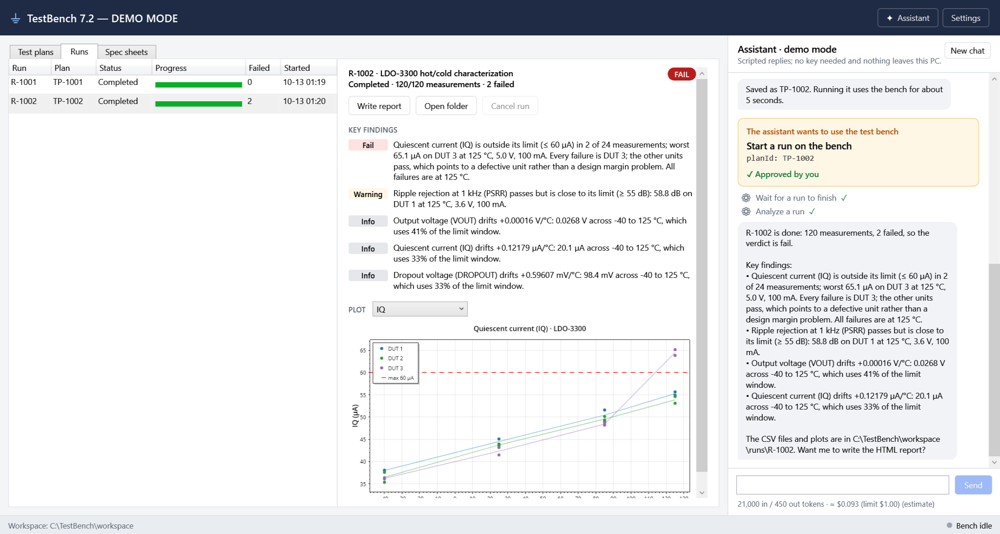

## Why

Companies ship desktop tools that run on customer machines. Some of those customers would love to "just ask it"; others already use Claude Code or Codex and want their agent to drive the tool. This repo shows one sensible way to serve both, and **writes down why** each decision was made:

- **Off by default**, and nothing leaves the PC until the user turns AI on and asks something.
- **The customer pays**: their own API key (encrypted with Windows DPAPI), or better, their company's AI gateway. No vendor key ships in the binary.
- **AI can only do what a person could do**, through the same validated code. Anything that creates files or uses the bench needs a person's approval.
- **The app computes, the model explains.** The model never writes the XML or does the statistics.

## How it works

Two programs, four ways in. A and B existed before AI; C and D are what this demo adds.

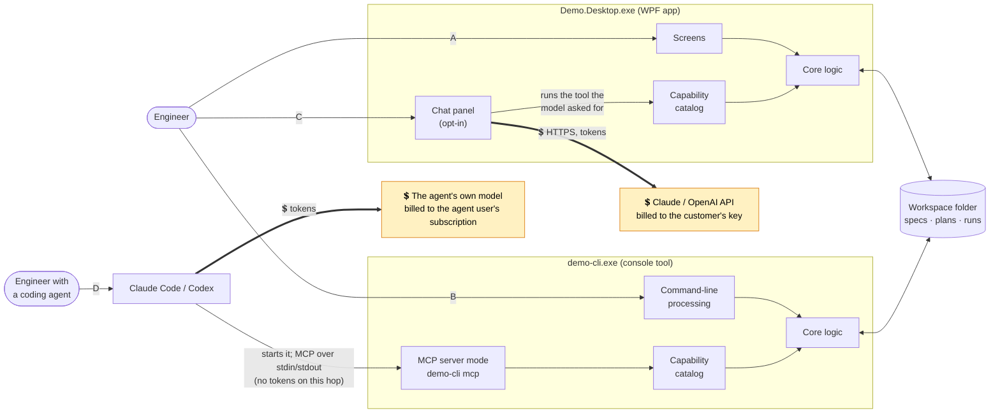

**💲 marks every place tokens are spent.** Thick arrows are model calls; everything else is ordinary local code and file access.

| Path | In plain words | AI? | Who pays |
|---|---|---|---|
| **A** | An engineer clicks around the desktop app. Unchanged legacy behavior. | No | n/a |
| **B** | An engineer or a script runs `demo-cli` commands. Unchanged legacy behavior. | No | n/a |
| **C** | An engineer types in the chat panel. 💲 Our app sends the question and a list of tools to Claude/OpenAI; the model replies "call tool X"; our app asks the user if X creates files or uses the bench, runs it, and 💲 sends the result back, until the model answers in words. | Yes, **our app** calls the model | Customer's key or gateway |
| **D** | An engineer asks Claude Code or Codex. 💲 The agent asks its own model what to do; when it decides to use a tool, it **starts `demo-cli mcp`** as a child process and calls the tool over MCP. Our code never talks to a model. | Yes, but **only in their agent** | Their own subscription |

### Where tokens are spent

| Activity | Calls a model? | Whose tokens |
|---|---|---|
| Using the screens or `demo-cli` commands (paths A, B) | **No** | none |
| Running a plan, writing CSVs/plots, analyzing results, writing the report | **No.** The core logic is ordinary code | none |
| Each message in the chat panel (path C) | **Yes.** Several requests per message: one per model↔tool round trip, each resending the conversation so far | **The customer's** API key, or their company gateway |
| A coding agent using `demo-cli mcp` (path D) | `demo-cli` never does. The *agent* calls its own model to decide which tool to use next | **The agent user's** own subscription |
| `--demo` mode, the screenshots, `dotnet test` | **No.** A scripted fake model stands in | none |
| `DEMO_LIVE_TESTS=1` | **Yes**, one small request per provider | Whoever's key is in the environment |

The important points:

- **Nothing in our apps "calls MCP".** MCP is a door *into* the console tool for coding agents.
- **The model never touches files or the bench.** It can only *ask* for a tool; our code decides and runs it.
- **The capability catalog is defined once** (13 tools, each Read, Write or Execute) and is used by both the chat panel and MCP. The chat panel adds one more read-only tool of its own, `get_current_view`, so the assistant can see which plan or run you're looking at. All four paths end in the same core logic, so the same rules apply to everyone.
- **MCP inside the desktop app is optional and not built.** The design explains when you'd want it and what it would take to secure.

**Full explanation, with step-by-step sequence diagrams: [docs/design.md](docs/design.md).**

## Walkthrough

These screenshots are generated by `scripts/capture-screenshots.ps1`, which drives the real apps. They are never taken by hand.

**1. The legacy tool, unchanged.** Test plans (XML), runs with findings and plots, and the customer's spec sheets. No AI anywhere until someone opts in.

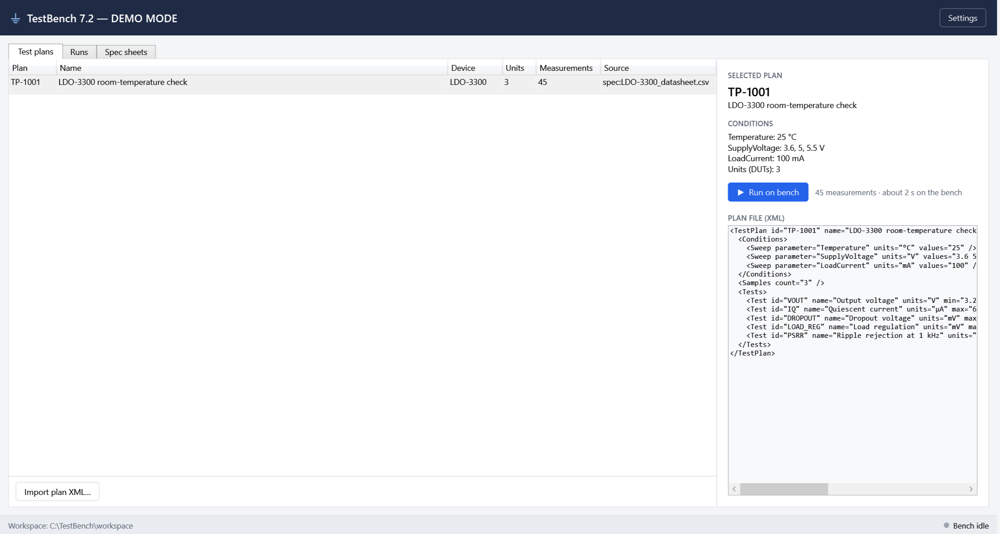
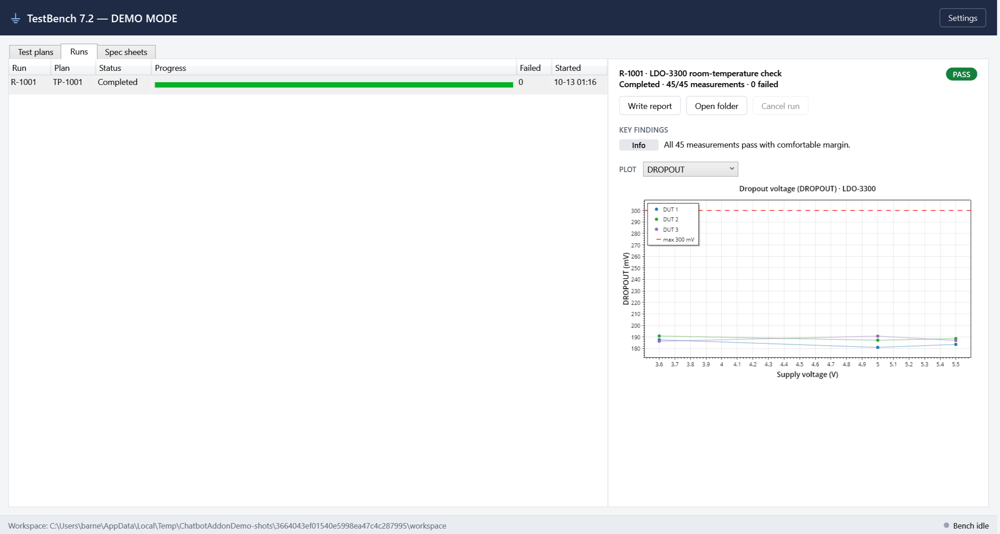
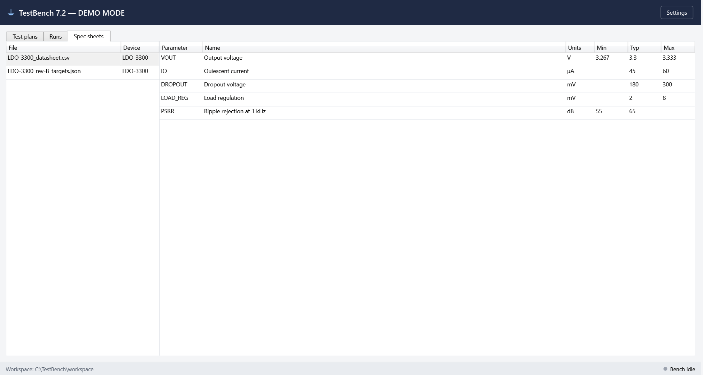

**2. Opting in.** Settings explains what gets sent and who pays, then asks for a key (or uses the company gateway).

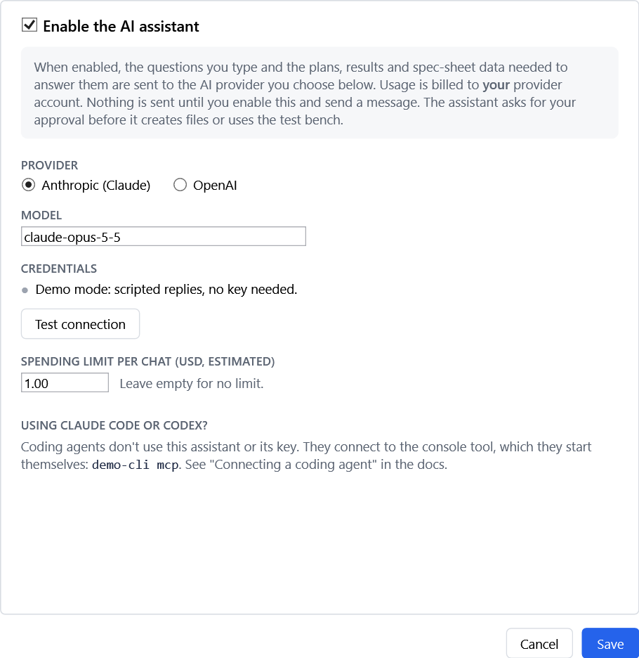

**3. Asking in plain English.** "Make a hot/cold plan for the LDO-3300 from its datasheet … then run it." The assistant reads the spec sheets on its own, but **creating the plan file needs approval**:

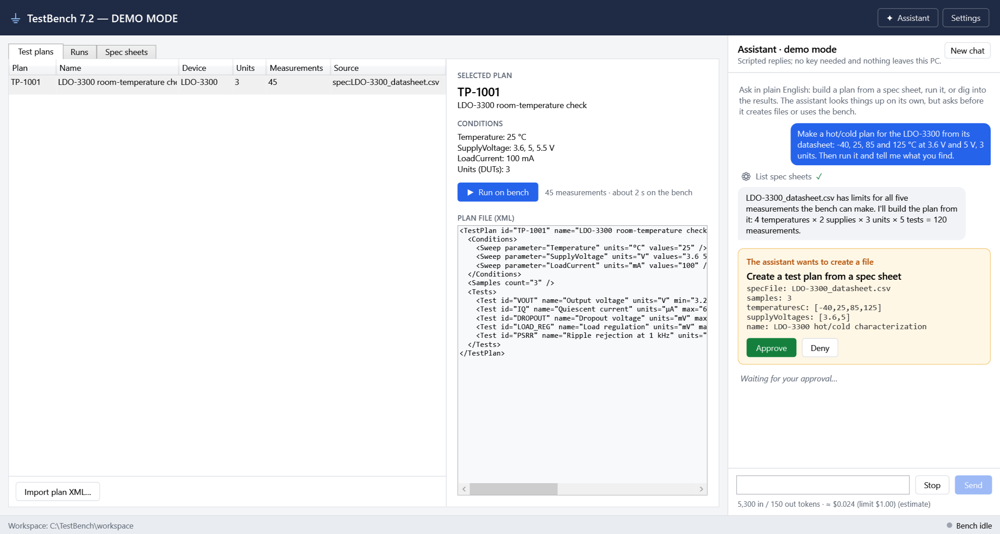

**4. Using the bench needs a second approval.** The new plan TP-1002 is already in the grid, validated and saved by the app, not written by the model.

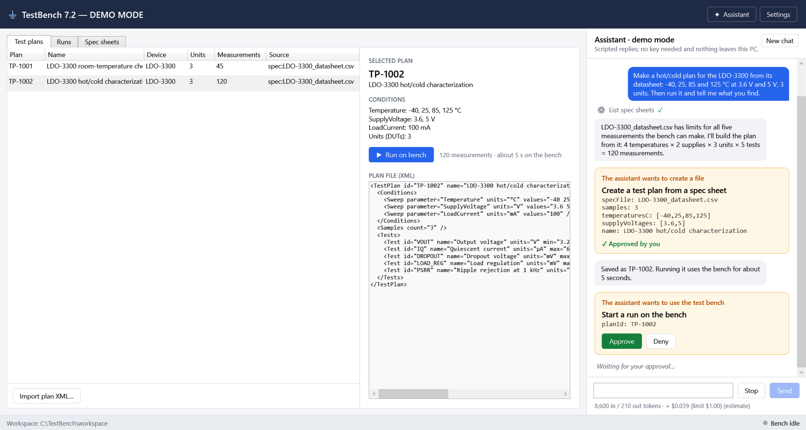

**5. Results.** The run executes on the (simulated) bench. The app computes the findings: one unit (DUT 3) fails quiescent current at 125 °C while the others pass, so it's a bad part rather than a design problem. The assistant explains them, and you can ask follow-ups about specific conditions:

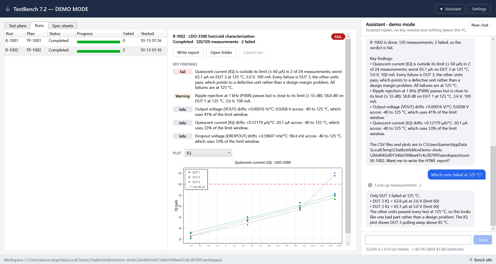

The run's real output files: `results.csv`, `summary.csv`, `report.html`, and a plot per test:

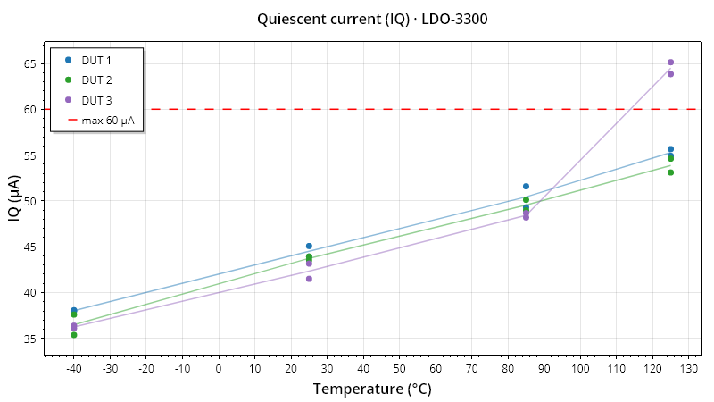

**6. The console tool**, used exactly as before with no AI involved:

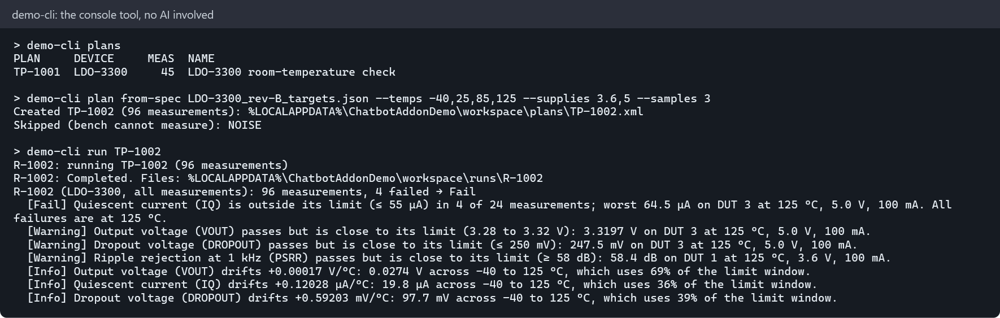

**7. A coding agent's view.** The agent starts `demo-cli mcp`, sees the tools (marked read, write or bench), and plans, runs and analyzes:

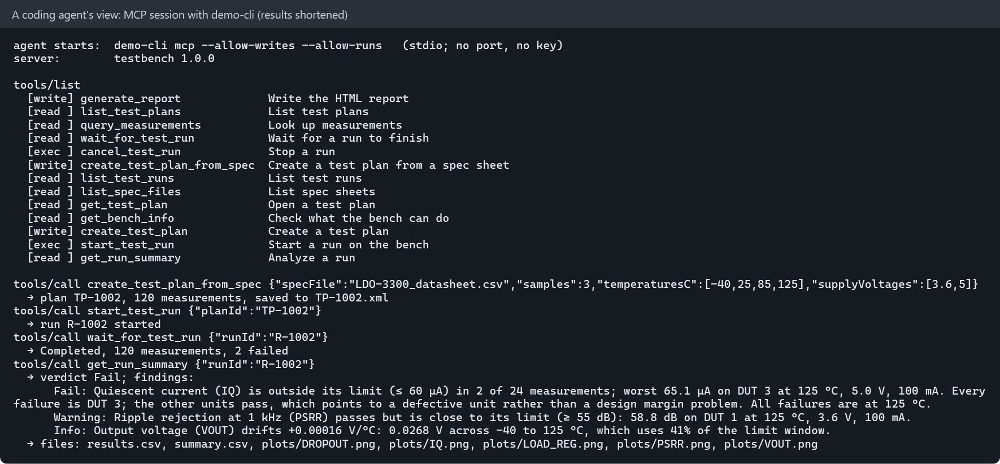

## Usage

Requires Windows and the .NET 10 SDK.

```powershell
dotnet build ChatbotAddonDemo.sln

# Desktop app in demo mode: fresh example workspace, scripted assistant, no key needed
.\src\Demo.Desktop\bin\Debug\net10.0-windows\Demo.Desktop.exe --demo

# Desktop app for real (workspace in %LOCALAPPDATA%\ChatbotAddonDemo\workspace); turn on AI in Settings
.\src\Demo.Desktop\bin\Debug\net10.0-windows\Demo.Desktop.exe

# Console tool
.\src\Demo.Cli\bin\Debug\net10.0\demo-cli.exe help

# Tests. No network, no key, nothing billed. The UI tests open the app off-screen.
dotnet test ChatbotAddonDemo.sln

# Paid live-API smoke tests (one call per provider), only when you explicitly opt in
$env:DEMO_LIVE_TESTS = '1'; dotnet test --filter Category=Live

# Regenerate every screenshot in docs/images
.\scripts\capture-screenshots.ps1
```

Connect a coding agent: [docs/guides/connecting-a-coding-agent.md](docs/guides/connecting-a-coding-agent.md).

## Docs

| Document | For |
|---|---|
| [Design](docs/design.md) | Everyone: who calls what, why each piece exists, diagrams |
| [Decision records](docs/adr/) | Why each major choice was made, and what we rejected |
| [Security notes](docs/security.md) | Threats and mitigations |
| [Using the assistant](docs/guides/using-the-assistant.md) | End users |
| [Connecting a coding agent](docs/guides/connecting-a-coding-agent.md) | Claude Code / Codex users |
| [IT admin deployment](docs/guides/it-admin-deployment.md) | Rolling out keys or an AI gateway |

## Layout

```
src/
  Demo.Domain/         Core logic: plans (XML + XSD), spec import, simulated bench, result files, plots, analysis. No AI.
  Demo.Capabilities/   The capability catalog: what AI may do (Read / Write / Execute), defined once.
  Demo.Ai/             Calling Claude/OpenAI (IChatClient), chat loop with approvals, credentials, cost meter.
  Demo.Desktop/        WPF app: the legacy screens + the opt-in chat panel.
  Demo.Cli/            Console tool: the legacy commands + `demo-cli mcp` for coding agents.
tests/                 Domain, capabilities, AI (scripted model), CLI/MCP end-to-end, desktop UI tests.
tools/Demo.Screenshots Drives the apps and renders docs/images.
docs/                  Design, decision records, security, guides, images.
scripts/               capture-screenshots.ps1
```

## Contributing

This is a personal tool, published as-is — **issues and pull requests aren't accepted** (PRs auto-close). Fork it and make it your own. 🔌

## License

MIT — see [LICENSE](LICENSE). © 2026 RelentlessOldMan.
