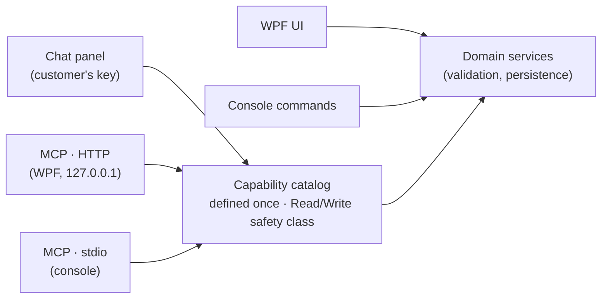
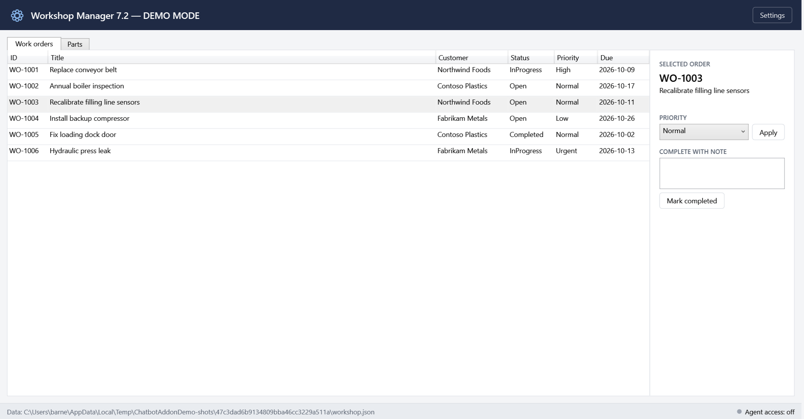
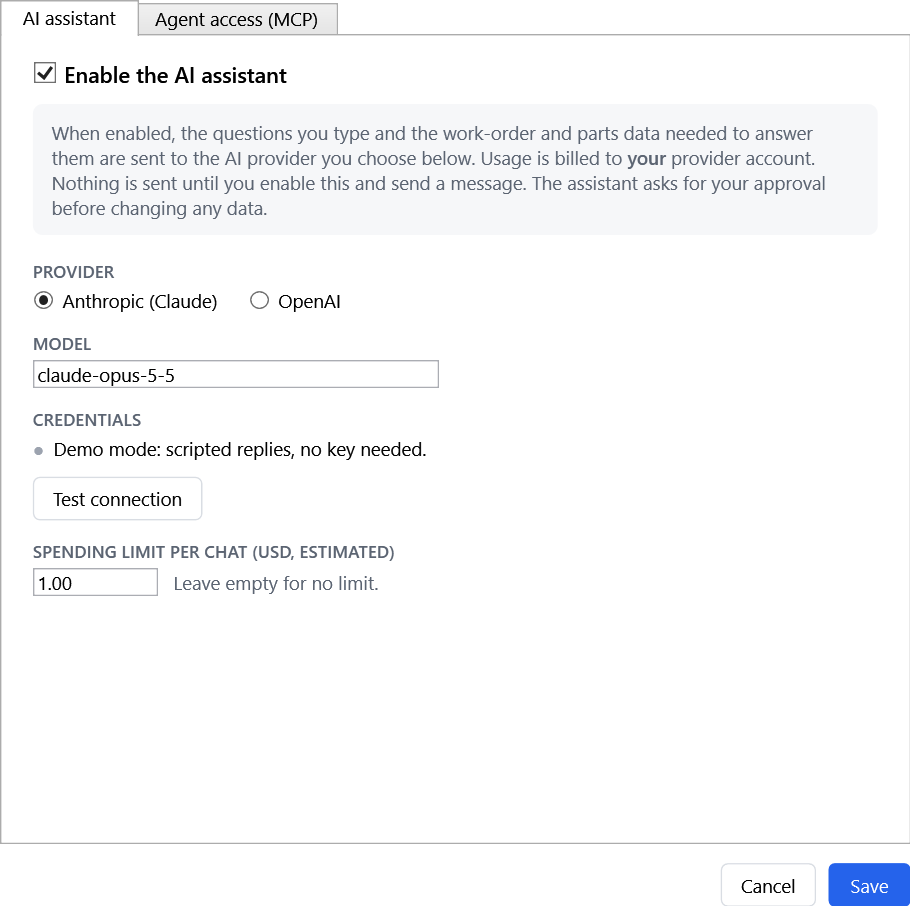
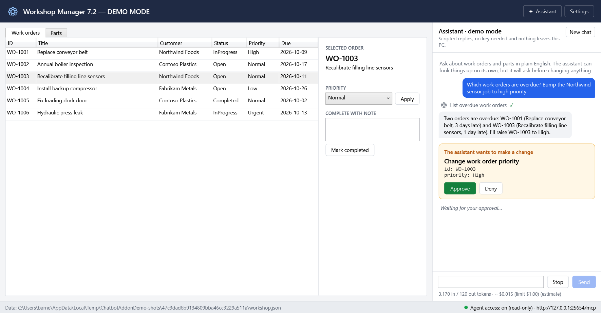
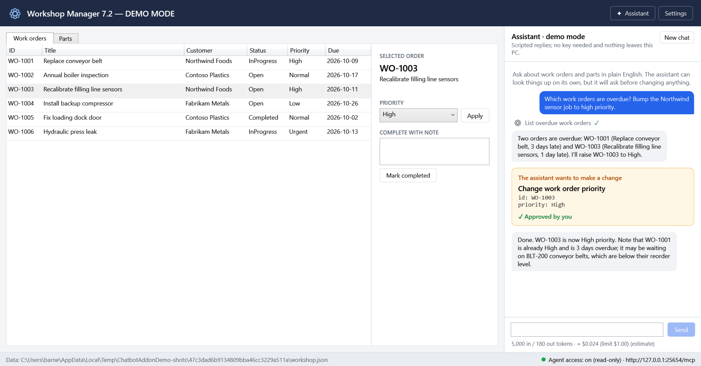
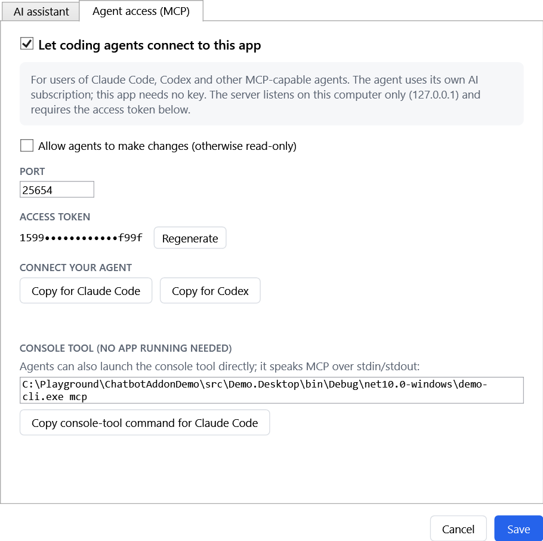
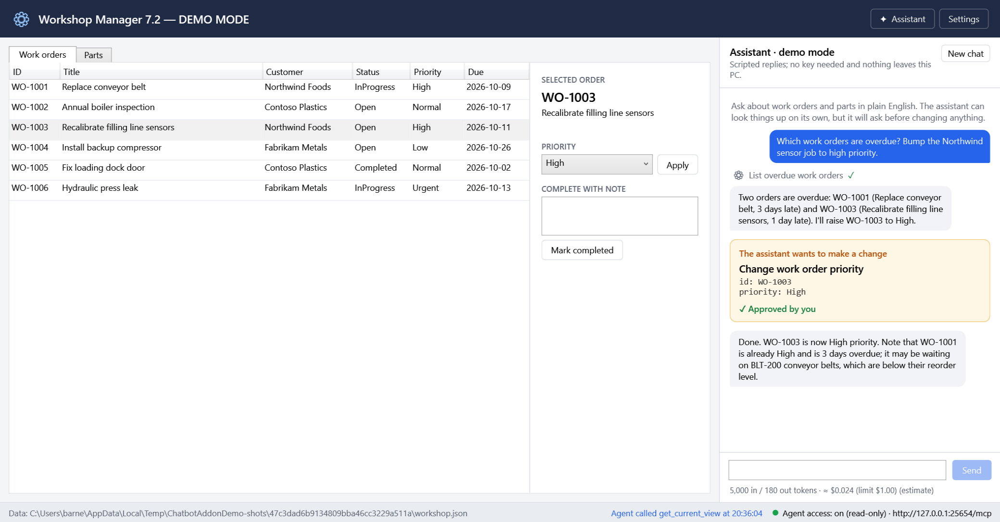
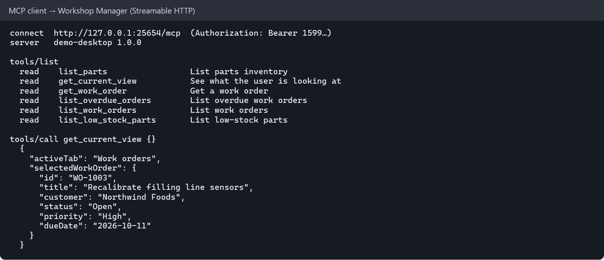
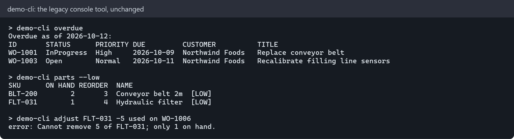
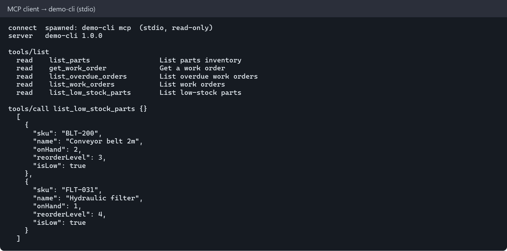

# Chatbot add-on demo: adding AI to a legacy desktop tool

A reference implementation showing how we **should** add AI to Windows desktop tools that run on customer machines, for two audiences:

- **Customers who just want to ask it things:** an opt-in **chat assistant** inside the WPF app, using the customer's own Anthropic or OpenAI account.
- **Customers who already use coding agents** (Claude Code, Codex, …): an **MCP server** in both the WPF app and the console tool, so their agent can drive our software.

> The "legacy" domain (work orders + parts inventory) is a **placeholder**. Everything outside `src/Demo.Domain` and `src/Demo.Capabilities/Workshop` is domain-agnostic.

**Read next:** [Design & reasoning](docs/design.md) · [Decision records](docs/adr/) · [Security notes](docs/security.md) · Guides: [end users](docs/guides/using-the-assistant.md), [agent users](docs/guides/connecting-a-coding-agent.md), [IT admins](docs/guides/it-admin-deployment.md)

## The idea in one picture



Each operation is declared **once**, as a method with `[Capability("set_work_order_priority", SafetyClass.Write)]`. It becomes a chat tool and an MCP tool, and it always runs through the same business rules as the UI. Read operations run freely. Write operations need a human's approval in chat, and are hidden from agents unless the user allows changes.

## Walkthrough

All images below are generated by `scripts/capture-screenshots.ps1`, which drives the real apps (see [Screenshots](#screenshots)).

**1. The legacy app, as customers know it.** With AI off (the default), nothing changes and nothing is sent anywhere.



**2. Opting in.** Settings explains what gets sent and who pays, then lets the user pick a provider and enter a key. The key is encrypted with Windows DPAPI for that user, and IT can supply a gateway instead.



**3. Asking in plain English.** The assistant looked up overdue orders by itself (a read). Changing a priority is a write, so it **asks first**, and the grid still shows `Normal`. The footer shows token usage and estimated cost against a per-chat limit.



**4. After approval.** The change went through the same `WorkshopService` the UI uses, and the grid updated live.



**5. Agent access.** A separate opt-in. It is local-only, needs a token, and is read-only unless the user allows changes. One click copies a ready-made config for Claude Code or Codex.



**6. A coding agent connected.** It can see what the user has selected (`get_current_view`), which is why agents attach to the *running* app rather than spawning a copy. The status bar shows agent activity.




**7. The console tool.** It is unchanged for scripts, and `demo-cli mcp` turns it into a stdio MCP server for agents.




## Repository layout

| Path | What |
|---|---|
| `src/Demo.Domain` | Placeholder legacy logic (no AI knowledge) |
| `src/Demo.Capabilities` | Capability catalog → `AIFunction`; `Workshop/` holds the domain-specific declarations |
| `src/Demo.Ai` | `IChatClient` factory (Anthropic + OpenAI), credentials (DPAPI, env, IT gateway), `ChatSession` with approvals, usage/cost meter, scripted fake model |
| `src/Demo.Mcp` | Catalog → MCP tools, exposure policy, stdio host, hardened loopback HTTP host, client config snippets |
| `src/Demo.Desktop` | WPF app with chat panel, settings, MCP status, `--demo` mode |
| `src/Demo.Cli` | Console tool (`demo-cli`), including `demo-cli mcp` |
| `tests/*` | Unit, integration (real MCP clients), and FlaUI UI tests |
| `tools/Demo.Screenshots` | Regenerates `docs/images` |

## Build, run, test

Requires the .NET 10 SDK on Windows.

```powershell
dotnet build ChatbotAddonDemo.sln

# Run the desktop app in demo mode: seeded data, scripted assistant, no key needed
.\src\Demo.Desktop\bin\Debug\net10.0-windows\Demo.Desktop.exe --demo

# Run it for real (uses %LOCALAPPDATA%\ChatbotAddonDemo); enable AI in Settings
.\src\Demo.Desktop\bin\Debug\net10.0-windows\Demo.Desktop.exe

# Console tool
.\src\Demo.Cli\bin\Debug\net10.0\demo-cli.exe overdue

# All tests: no network, no key, nothing billed. UI tests open the app briefly.
dotnet test ChatbotAddonDemo.sln

# Paid live-API smoke tests (both providers), only when you explicitly opt in
$env:DEMO_LIVE_TESTS = '1'; dotnet test tests/Demo.Ai.Tests --filter Category=Live
```

## Screenshots

```powershell
.\scripts\capture-screenshots.ps1
```

This builds the solution and launches `Demo.Desktop --demo`, which uses a throwaway profile and a scripted assistant whose tools still really execute. It clicks through the walkthrough using UI Automation and makes real MCP calls to both apps. The app renders its own windows to PNG over a demo-only named pipe, so capture works with a locked screen or on a build agent, and the output is the same on every machine. No key or network is needed. Rerun it after any UI change and commit `docs/images`.
