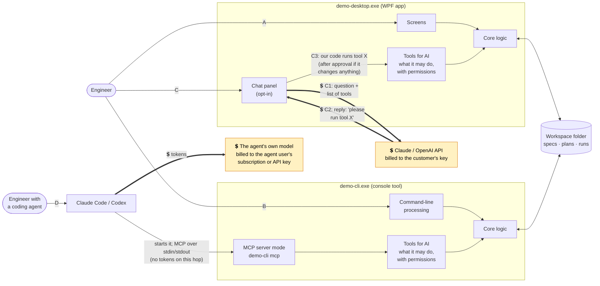
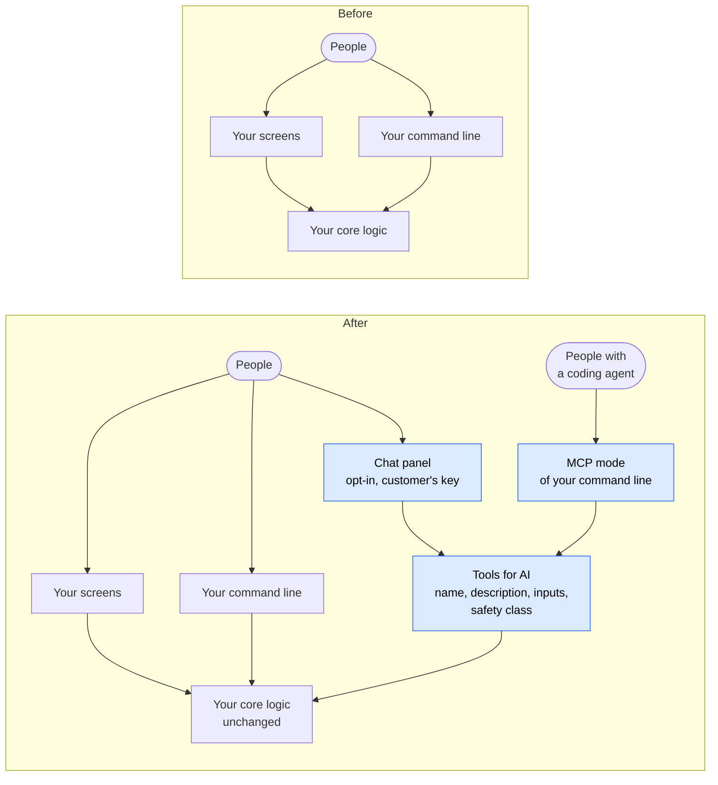

# ChatbotAddonDemo 🔌

**A reference demo of how to add AI to a legacy Windows desktop tool: an opt-in chat assistant for everyday users, MCP access for people who use coding agents, and the customer paying for their own tokens.** The "legacy tool" is TestBench, a pretend test-bench application (WPF app + console tool). It turns spec sheets into XML test plans, runs them on a simulated bench, writes CSV and PNG results, and analyzes them for key findings.


## Why

Companies ship desktop tools that run on customer machines. Some of those customers would love to "just ask it"; others already use Claude Code or Codex and want their agent to drive the tool. This repo shows one sensible way to serve both, and **writes down why** each decision was made:

- **Off by default**, and nothing leaves the PC until the user turns AI on and asks something.
- **The customer pays**: their own API key (encrypted with Windows DPAPI, the built-in per-user encryption), or better, their company's AI gateway (a proxy run by their IT that holds the vendor key). No vendor key ships in the binary.
- **AI can only do what a person could do**, through the same validated code. Anything that changes data or acts on the outside world (here: creating files, starting the bench) needs a person's OK: an approval card in the chat panel; for coding agents, the flags chosen when connecting plus the agent's own permission prompts.
- **The app computes, the model explains.** The model never writes the app's files or computes results (here: the XML and the statistics).

## Words used here

| Word | Meaning |
|---|---|
| **MCP** | Model Context Protocol: the standard way coding agents such as Claude Code plug in outside tools. |
| **Token** | The unit AI providers bill by, roughly ¾ of a word, counted on everything sent and everything received. |
| **Tools for AI** (capability catalog) | The list of operations the AI may ask the app to run: name, a description the model reads, inputs, and a safety class. Project `Demo.Capabilities`. |
| **Safety class** | Read: only looks. Write: creates or changes files. Execute: acts on the outside world (here, the bench hardware). |
| **AI gateway** | A proxy run by the customer's IT that holds the vendor key and can enforce budgets and logging. |
| **Core logic** | The legacy tool's own code (`Demo.Domain`). Every path ends here. |

## How it works

Two programs, four ways in. A and B existed before AI; C and D are what this demo adds.


<sub>[Download this diagram as PNG](docs/images/diagrams/readme--how-it-works.png)</sub> <!-- diagram-png -->

**💲 marks every place tokens are spent.** Thick arrows are model calls; everything else is ordinary local code and file access.

**The model never touches the app.** It only sends back text that asks for a tool (C2). The chat panel, which is our code, looks that tool up in the tools for AI, asks you first if it would create files or use the bench, runs it (C3), and sends the result back in the next request (C1 again). This repeats until the model answers in words. Which provider and model to use (Claude or OpenAI, and the model name) comes from the app's Settings.

- **C1 + C2 together are one billed request**: tokens go out with the question, tokens come back with the reply.
- **Every request carries the whole conversation so far**, including earlier tool results such as spec limits and run findings. That is what leaves the PC, and why later requests in a chat cost more.
- **Each exe contains its own copy of the same libraries.** The two "Core logic" boxes are the same code, compiled into both programs. The programs share data only through the workspace folder.

| Path | In plain words | AI? | Who pays |
|---|---|---|---|
| **A** | An engineer clicks around the desktop app. Unchanged legacy behavior. | No | n/a |
| **B** | An engineer or a script runs `demo-cli` commands. Unchanged legacy behavior. | No | n/a |
| **C** | An engineer types in the chat panel. 💲 Our app sends the question and a list of tools to Claude/OpenAI; the model replies "call tool X"; if X would create files or use the bench, our app asks the user first; it runs X and 💲 sends the result back, until the model answers in words. | Yes, **our app** calls the model | Customer's key or gateway |
| **D** | An engineer asks Claude Code or Codex. 💲 The agent asks its own model what to do; when it decides to use a tool, it **starts `demo-cli mcp`** as a child process and calls the tool over MCP. Our code never talks to a model. | Yes, but **only in their agent** | Their own subscription or API key |

### Where tokens are spent

| Activity | Calls a model? | Whose tokens |
|---|---|---|
| Using the screens or `demo-cli` commands (paths A, B) | **No** | none |
| Running a plan, writing CSVs/plots, analyzing results, writing the report | **No.** The core logic is ordinary code | none |
| 💲 Each message in the chat panel (path C) | **Yes.** Several requests per message: one per model↔tool round trip, each resending the conversation so far | **The customer's** API key, or their company gateway |
| 💲 A coding agent using `demo-cli mcp` (path D) | `demo-cli` never does. The *agent* calls its own model to decide which tool to use next | **The agent user's** own subscription or API key |
| 💲 "Test connection" in Settings | **Yes**, one tiny request | The customer's key or gateway |
| `--demo` mode, the screenshots, `dotnet test` | **No.** A scripted fake model stands in | none |
| 💲 `DEMO_LIVE_TESTS=1` | **Yes**: a short chat per provider, and the whole walkthrough job with each provider and with Claude Code and Codex | Whoever's key is in the environment, and the agent users' accounts |

The important points:

- **Nothing in our apps "calls MCP".** MCP is a door *into* the console tool for coding agents.
- **The model never touches files or the bench.** It can only *ask* for a tool; our code decides and runs it.
- **The tools for AI (capability catalog) are defined once**: 13 tools, each with a name and description the model reads, its inputs, and a safety class (Read / Write / Execute). They are used by both the chat panel and MCP. The chat panel adds one more read-only tool of its own, `get_current_view`, so the assistant can see which plan or run you're looking at. All four paths end in the same core logic, so the same rules apply to everyone.
- **MCP inside the desktop app is optional and not built.** The design explains when you'd want it and what it would take to secure.

**Full explanation, with step-by-step sequence diagrams and the rules for every chat message: [docs/design.md](docs/design.md).** What leaves the PC on each path is drawn in [docs/security.md](docs/security.md#6-data-leaving-the-pc).

## Applying this to your own tool

TestBench is only the example. For your own desktop tool, the existing parts stay as they are and you add three new ones (blue):


<sub>[Download this diagram as PNG](docs/images/diagrams/readme--applying-this-to-your-own-tool.png)</sub> <!-- diagram-png -->

1. **Tools for AI:** a class that wraps the operations you already have, one method each, with a description for the model and a safety class (Read / Write / Execute). Here: [`TestBenchCapabilities.cs`](src/Demo.Capabilities/TestBench/TestBenchCapabilities.cs).
2. **Chat panel:** connects to the provider with the customer's key or gateway, sends the tools with each message, and shows an approval card before anything that isn't Read. Here: [`Demo.Ai`](src/Demo.Ai) plus the panel in `Demo.Desktop`.
3. **MCP mode:** one more command on your console tool that serves the same tools to coding agents over stdin/stdout. Here: `demo-cli mcp` in [`Demo.Cli`](src/Demo.Cli).

The core logic isn't changed for AI, so its rules apply to every path.

## Walkthrough

These screenshots are generated by `scripts/capture-screenshots.ps1`, which drives the real apps. They are never taken by hand.

**1. The legacy tool, unchanged.** Test plans (XML), runs with findings and plots, and the customer's spec sheets. No AI anywhere until someone opts in.


**2. Opting in.** Settings explains what gets sent and who pays, then asks for a key (or uses the company gateway).


**3. Asking in plain English.** "Make a hot/cold plan for the LDO-3300 from its datasheet … then run it." The assistant reads the spec sheets on its own, but **creating the plan file needs approval**:


**4. Using the bench needs a second approval.** The new plan TP-1002 is already in the grid, validated and saved by the app, not written by the model.


**5. Results.** The run executes on the (simulated) bench. The app computes the findings: one unit (DUT 3) fails quiescent current at 125 °C while the others pass, so it's a bad part rather than a design problem. The assistant explains them, and you can ask follow-ups about specific conditions:


The run's real output files: `results.csv`, `summary.csv`, a plot per test, and `report.html` (when requested: Write report button, `generate_report` or `demo-cli report`):


**6. The console tool**, used exactly as before with no AI involved:


**7. A coding agent's view.** The agent starts `demo-cli mcp`, sees the tools (each marked with its safety class: read / write / exec), and plans, runs and analyzes:


## Usage

Requires Windows and the .NET 10 SDK.

```powershell
dotnet build ChatbotAddonDemo.sln

# Desktop app in demo mode: fresh example workspace, scripted assistant, no key needed.
# --demo uses a throwaway workspace in %TEMP%; to watch demo-cli or an agent change it live,
# run without --demo or pass the same --workspace to both.
.\src\Demo.Desktop\bin\Debug\net10.0-windows\demo-desktop.exe --demo

# Desktop app for real (workspace in %LOCALAPPDATA%\ChatbotAddonDemo\workspace); turn on AI in Settings
.\src\Demo.Desktop\bin\Debug\net10.0-windows\demo-desktop.exe

# Console tool
.\src\Demo.Cli\bin\Debug\net10.0\demo-cli.exe help

# Tests. Nothing billed: the AI paths talk to a fake AI gateway on 127.0.0.1. The UI tests open the app off-screen.
# GitHub runs the same tests, except the UI tests, on every push (.github/workflows/build.yml).
dotnet test ChatbotAddonDemo.sln

# 💲 Paid live tests, only when you explicitly opt in: the same job with real Claude and OpenAI (path C)
# and real Claude Code and Codex (path D). Roughly $1 in all; the Claude chat and Claude Code stop at $0.50 each,
# the OpenAI chat at 200,000 tokens, Codex at 5 minutes. Each test skips itself if its key or agent is missing.
# The switch is removed again afterwards, so a later plain `dotnet test` in this window costs nothing.
$env:DEMO_LIVE_TESTS = '1'; dotnet test --filter Category=Live; Remove-Item Env:DEMO_LIVE_TESTS

# Re-render every diagram to PNG (docs/images/diagrams) after editing one. Needs Node.js, Chrome or Edge, and
# internet access the first time (it downloads the Mermaid renderer from npm). Headless.
node scripts/render-diagrams.mjs

# Regenerate every screenshot in docs/images (the apps open off-screen)
powershell -ExecutionPolicy Bypass -File scripts\capture-screenshots.ps1
```

Environment variables (all optional):

| Variable | Effect |
|---|---|
| `DEMO_WORKSPACE` | Workspace folder for both `demo-desktop` (also with `--demo`) and `demo-cli`. A `--workspace` argument wins over it. Default: `%LOCALAPPDATA%\ChatbotAddonDemo\workspace` (with `--demo`: a throwaway folder in `%TEMP%`). |
| `DEMO_BENCH_DELAY_MS` | `0` makes the simulated bench instant (the tests use this). Any other value, or unset, runs at demo speed (a few seconds per run). |
| `ANTHROPIC_API_KEY`, `OPENAI_API_KEY` | A personal key for the chat panel, used when no company gateway is set (see the [IT admin guide](docs/guides/it-admin-deployment.md)). |
| 💲 `DEMO_LIVE_TESTS` | `1` enables the paid live-API tests. |
| `DEMO_CLAUDE_EXE`, `DEMO_CODEX_EXE` | Where the live tests find Claude Code or Codex, if not on PATH. |

Connect a coding agent: [docs/guides/connecting-a-coding-agent.md](docs/guides/connecting-a-coding-agent.md).

## Docs

| Document | For |
|---|---|
| [Design](docs/design.md) | Everyone: who calls what, why each piece exists, diagrams |
| [Decision records](docs/adr/) | Why each major choice was made, and what we rejected |
| [Security notes](docs/security.md) | Threats and mitigations |
| [Using the assistant](docs/guides/using-the-assistant.md) | End users |
| [Connecting a coding agent](docs/guides/connecting-a-coding-agent.md) | Claude Code / Codex users |
| [IT admin deployment](docs/guides/it-admin-deployment.md) | Rolling out keys or an AI gateway |

## Layout

```
src/
  Demo.Domain/         Core logic: plans (XML + XSD), spec import, simulated bench, result files, plots, analysis. No AI.
  Demo.Capabilities/   The tools for AI (capability catalog): what AI may do, with a safety class each (Read / Write / Execute), defined once.
  Demo.Ai/             Calling Claude/OpenAI (IChatClient), chat loop with approvals, credentials, cost meter.
  Demo.Desktop/        demo-desktop.exe, the WPF app: the legacy screens + the opt-in chat panel.
  Demo.Cli/            demo-cli.exe, the console tool: the legacy commands + `demo-cli mcp` for coding agents.
tests/                 Domain, capabilities, AI (scripted model), CLI/MCP end-to-end, every path with the same job, desktop UI tests.
tools/Demo.Screenshots Drives the apps and renders docs/images.
docs/                  Design, decision records, security, guides, images.
scripts/               capture-screenshots.ps1, render-diagrams.mjs
```

## Contributing

This is a personal project, published as-is — **issues and pull requests aren't accepted** (PRs auto-close). Fork it and make it your own. 🔌

## License

MIT — see [LICENSE](LICENSE). © 2026 RelentlessOldMan.
