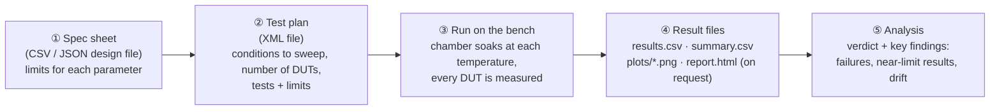
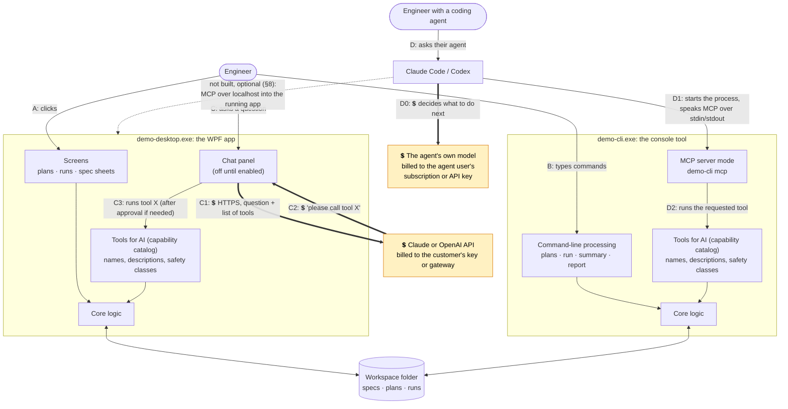
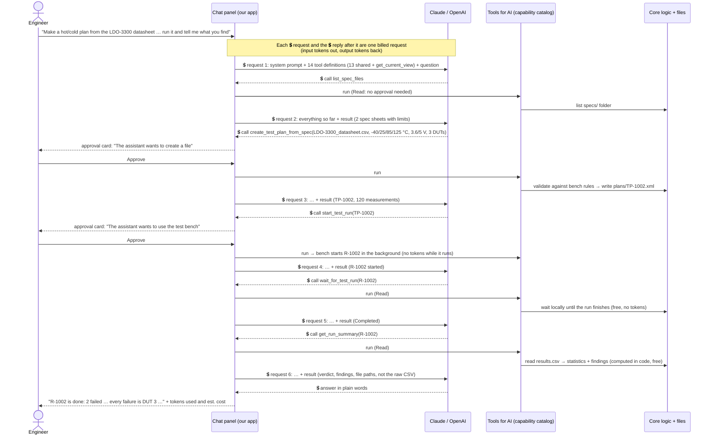
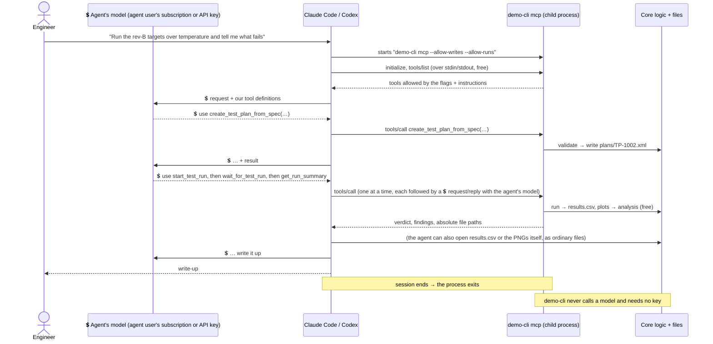
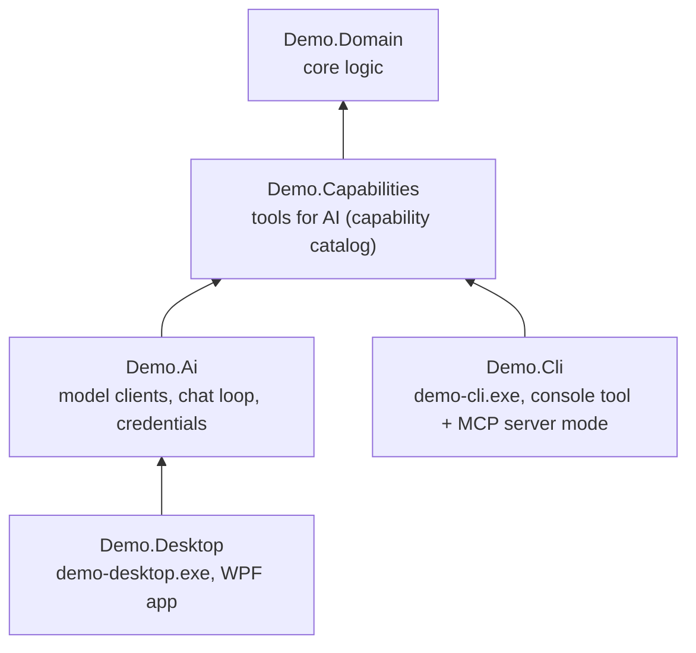

# Design: adding AI to a legacy desktop tool

This document explains how the demo is put together and why. If you only read one section, read [§3 Who calls what](#3-who-calls-what-the-runtime-picture).

**Contents**

1. [What we are demonstrating](#1-what-we-are-demonstrating)
2. [The pretend legacy tool: TestBench](#2-the-pretend-legacy-tool-testbench)
3. [Who calls what: the runtime picture](#3-who-calls-what-the-runtime-picture)
4. [Why each piece exists](#4-why-each-piece-exists)
5. [The tools for AI (capability catalog): one list of what AI may do](#5-the-tools-for-ai-capability-catalog-one-list-of-what-ai-may-do)
6. [Path C in detail: the chat assistant](#6-path-c-in-detail-the-chat-assistant)
7. [Path D in detail: coding agents over MCP](#7-path-d-in-detail-coding-agents-over-mcp)
8. [Optional, not built: MCP inside the desktop app](#8-optional-not-built-mcp-inside-the-desktop-app)
9. [The app does the work; the model orchestrates and explains](#9-the-app-does-the-work-the-model-orchestrates-and-explains)
10. [Security in one table](#10-security-in-one-table)
11. [Testing](#11-testing)
12. [Screenshots are generated, not taken by hand](#12-screenshots-are-generated-not-taken-by-hand)
13. [Build dependencies (compile time, not runtime)](#13-build-dependencies-compile-time-not-runtime)
14. [Open items](#14-open-items)

---

## 1. What we are demonstrating

We ship Windows desktop tools that run **on customer machines**. We want to show one workable way to let customers use AI with them, for two kinds of customer:

| Persona | Who they are | What they want | What we give them |
|---|---|---|---|
| **"Just let me ask it"** | Engineers and technicians. They don't know or care what Claude, Codex or MCP are. | Type "make a hot/cold plan from the datasheet and run it" and get it done, then ask questions about the results. | An **opt-in chat panel** in the desktop app. |
| **"I have my own agent"** | Engineers who already use Claude Code, Codex or Cursor. | Have their agent drive our tool as part of bigger work, e.g. "run the rev-B targets over temperature and write up what fails". | An **MCP server mode** in the console tool: `demo-cli mcp`. |

Four constraints shape every decision:

1. **The customer pays for AI.** We never ship a vendor API key. The chat panel uses the customer's own key or their company's AI gateway; coding agents use their own subscription or API key.
2. **It runs on the customer's PC.** There is no backend of ours in the loop.
3. **Off by default.** A customer who never opts in sees no change and no network traffic.
4. **AI can only do what a person could do**, through the same validated code, and anything that changes data or acts on the outside world (here: creating files, starting the bench) needs a person's OK.

## 2. The pretend legacy tool: TestBench

The two apps simulate a typical engineering test tool. It controls a test bench (a temperature chamber, a power supply, and meters) that measures voltage-regulator chips. Each chip on the bench is a **DUT** (device under test). The bench is simulated, but the workflow is the real one:



All state is **plain files in a workspace folder**, which is how real tools of this kind tend to work:

```
workspace\
  specs\   LDO-3300_datasheet.csv, LDO-3300_rev-B_targets.json   ← the customer's design files
  plans\   TP-1001.xml, TP-1002.xml, TestPlan.xsd                ← test plans
  runs\    R-1001\ run.json, results.csv, summary.csv, plots\*.png,
                   report.html (when requested: Write report button, generate_report or demo-cli report)
```

Both apps open the same workspace: by default `%LOCALAPPDATA%\ChatbotAddonDemo\workspace`, or the folder given by a `--workspace` argument or the `DEMO_WORKSPACE` environment variable (both apps honour both). The desktop app's `--demo` mode uses a throwaway workspace in `%TEMP%` unless one of those is given; to watch the console tool or an agent change it live, run without `--demo` or pass the same `--workspace` to both. The desktop app watches the folder, so a plan created by the console tool, or by a coding agent through it, appears in the open window within a second.

The simulated bench produces realistic data: temperature drift, unit-to-unit spread, noise, and one weak unit (DUT 3) whose current draw runs away above 85 °C. That gives the analysis, and the AI, something real to find.

## 3. Who calls what: the runtime picture

There are **two programs** (`demo-desktop.exe` and `demo-cli.exe`) and **four ways in**: two that existed before AI (A and B) and two that the AI work adds (C and D).



**💲 marks every place tokens are spent.** The thick arrows are calls to a model; every other arrow is ordinary local code, process start-up or file access, and costs nothing.

### Reading the diagram

| Path | Who | What happens, step by step | AI involved? | Who pays for AI |
|---|---|---|---|---|
| **A** | Engineer at the desktop app | Clicks a button → the screen calls the core logic directly. *Unchanged legacy behavior.* | No | n/a |
| **B** | Engineer at a terminal or script | Types `demo-cli run TP-1001` → the command calls the core logic directly. *Unchanged legacy behavior.* | No | n/a |
| **C** | Engineer in the chat panel | **C1** 💲 the app sends the question and the list of tools to Claude/OpenAI. **C2** 💲 the model replies "call `create_test_plan_from_spec` with these arguments". **C3** the app shows an approval card if the tool creates files or uses the bench, then runs the tool through the tools for AI (capability catalog), which calls the core logic (free). The result goes back to the model, 💲 another billed request, and C1 to C3 repeat until it answers in words. | Yes, **our app** talks to the model | The customer, via their API key or gateway |
| **D** | Engineer using Claude Code / Codex | **D0** 💲 the agent sends the request to its own model, which decides to use one of our tools. **D1** the agent starts `demo-cli mcp` as a child process and talks to it over stdin/stdout. **D2** the console tool runs the tool through the same tools for AI and core logic and replies (free). The result goes back to the agent's model (💲 again, on the agent's side). The process exits when the agent session ends. | Yes, but **only inside their agent**; our code never talks to a model | The agent user, via their own subscription or API key. Our tool needs no key. |

### Where tokens are spent (and where they aren't)

| Activity | Calls a model? | Whose tokens | What drives the amount |
|---|---|---|---|
| Screens and `demo-cli` commands (paths A, B) | **No** | none | n/a |
| Bench runs, CSV/plot/report writing, analysis, validation | **No.** Ordinary code in Demo.Domain | none | n/a |
| 💲 One message in the chat panel (path C) | **Yes, usually several requests.** One per model↔tool round trip, e.g. 6 for the walkthrough in §6.1 | **The customer's** API key or company gateway | Each request resends the system prompt (the app's standing instructions to the model), the tool definitions and the whole conversation so far, so input tokens grow during a chat. Tool *results* count too, which is why the analysis tools return summaries rather than raw CSV (§9). "New chat" starts from zero. |
| 💲 A coding agent using our tools (path D) | **Our tool: never.** The *agent* calls its own model before and after every tool call | **The agent user's** own subscription or API key. We never see it or pay for it | The agent's own context; our tool descriptions and results are part of it, so short results help here too |
| 💲 "Test connection" in Settings | **Yes**, one tiny request, with the credential currently in use and the model typed in Settings | The customer's key or gateway | A few tokens |
| `--demo` mode, the screenshots, `dotnet test` | **No.** A scripted fake model replays the conversation; the tools still run for real | none | n/a |
| 💲 `DEMO_LIVE_TESTS=1` | **Yes**, one short chat (a few requests) per provider | Whoever's keys are in the environment | A few thousand tokens |

What the customer sees and controls: the panel shows tokens used and an estimated cost after every request; a per-chat limit (default $1.00) is checked *before* every request, including the automatic lookups within one message; and a cap on round trips between approvals stops a confused model from looping. See §6.4.

### Things the diagram makes explicit

- **Nothing in our apps "calls MCP".** MCP is a *door into* the console tool for coding agents. Our code is the MCP *server*; the agent is the client.
- **The model never touches files or the bench.** In path C the model only *asks* for a tool by name; our app decides whether to run it (approval) and runs it. In path D the same is true, with the agent in the middle.
- **Paths A and B don't go through the tools for AI**, and they don't need to. The catalog is the *AI-facing* adapter: tool names, descriptions written for models, JSON schemas, and safety classes. People already have their UI and commands. All four paths end in the same core logic, so the same rules (limits, ranges, "the bench runs one plan at a time") apply to everyone.
- **Each program contains its own copy of the catalog and the core logic.** They are libraries compiled into each exe, not services the exes call. The programs share state only through the workspace folder.
- **The chat panel and MCP are independent.** You can turn on either, both, or neither.

## 4. Why each piece exists

### The two programs

| Program | What it's for | Why it exists in the demo |
|---|---|---|
| **demo-desktop.exe** (WPF) | The everyday tool: look at plans, run them, review results and plots. | The **chat assistant lives here** because this is where non-technical users already are. It also knows what the user is looking at (`get_current_view`), so "analyze this run" works. |
| **demo-cli.exe** (console) | Scripted and batch work, e.g. nightly runs or CI. | **Coding agents connect here** (`demo-cli mcp`). An agent can start it on demand: no app needs to be open, there is no port to secure, and no token. See [ADR-004](adr/004-mcp-via-console-tool.md). There is **no chat** in the console tool: its users automate, and their AI is the agent. See [ADR-005](adr/005-no-chat-in-cli.md). |

### The libraries inside them

| Library (project) | Responsibility | Used by | Why it's a separate piece |
|---|---|---|---|
| **Demo.Domain**, the "core logic" | Plans (XML + schema + validation), spec-sheet import, the simulated bench, result files, plots, analysis, report. **Knows nothing about AI.** | Both programs | It's the legacy tool's core. Every way in ends here, so the rules are enforced once. |
| **Demo.Capabilities**, the "tools for AI" (capability catalog) | The list of what AI may do: 13 shared tools (the desktop app adds a 14th, `get_current_view`, for its chat panel only), each with a model-facing description, typed parameters (which become the JSON schema) and a safety class (Read / Write / Execute). | Both programs | Defined **once** and used by both the chat panel and MCP. Without it, chat tools and MCP tools would be written twice and drift apart. See [ADR-001](adr/001-capability-layer.md). |
| **Demo.Ai** | Talking to Claude/OpenAI (`IChatClient`), the chat loop with approvals, credentials (DPAPI, gateway, env var), cost meter. | Desktop app only | Everything about *our app calling a model*. The console tool doesn't reference it, because it never calls a model. |
| *(MCP server code, inside demo-cli)* | Turns the catalog into MCP tools and applies the `--allow-writes` / `--allow-runs` policy. | Console tool only | Small adapter: about 100 lines on top of the official MCP SDK. |

## 5. The tools for AI (capability catalog): one list of what AI may do

Each capability is a C# method with an attribute:

```csharp
[Capability("start_test_run", SafetyClass.Execute, Title = "Start a run on the bench")]
[Description("Starts running a plan on the bench and returns the new run id at once. ...")]
public object StartTestRun([Description("Plan id, e.g. 'TP-1002'.")] string planId) => ...
```

From that one definition we get an `AIFunction` for the chat panel (works with any `IChatClient`) and an MCP tool for agents (`McpServerTool.Create`). The **safety class** decides how each front end treats it:

| Safety class | Capabilities | Chat panel | MCP (console tool) | MCP annotations |
|---|---|---|---|---|
| **Read**: only looks | `get_bench_info`, `list_spec_files`, `list_test_plans`, `get_test_plan`, `list_test_runs`, `wait_for_test_run`, `get_run_summary`, `query_measurements`; plus `get_current_view` (desktop chat panel only) | Runs automatically; shown as a "⚙ …" line. Exception: a lookup the model asks for in the same step as a change also gets an approval card ("The assistant wants to look something up") | Always available | `readOnlyHint: true`, `idempotentHint: true` |
| **Write**: creates or changes files | `create_test_plan`, `create_test_plan_from_spec`, `generate_report` | **Approval card** ("The assistant wants to create a file") | Only with `--allow-writes` | `readOnlyHint: false`; `idempotentHint: true` for `generate_report` only |
| **Execute**: acts on the outside world (here, the bench hardware) | `start_test_run`, `cancel_test_run` | **Approval card** ("The assistant wants to use the test bench") | Only with `--allow-runs` | `readOnlyHint: false`, `openWorldHint: true`; `destructiveHint: true` for `cancel_test_run` only |

The MCP annotations are hints the coding agent uses for its own permission prompts: `readOnlyHint` = only looks; `idempotentHint` = calling it twice with the same inputs has no extra effect; `openWorldHint` = affects things outside the app (here, the bench); `destructiveHint` = may destroy work (a cancelled run's remaining measurements are never taken). All four hints are set on every tool, true or false; creating plans and starting runs always make new files, so they are not destructive.

Write and Execute are separate because they carry different risks. A wrong plan file costs nothing; a wrong bench run ties up shared hardware for hours in real life. An admin might allow an agent to draft plans but not run them.

Business-rule errors ("Temperature 200 °C is outside the bench range -55 to 150 °C") come back to the model as readable results, not exceptions, so it can correct itself or explain the problem to the user.

## 6. Path C in detail: the chat assistant

### 6.1 One conversation, step by step

This is the scripted conversation in the screenshots: the user asks for a plan from the datasheet, has it run, and wants the findings.



**This one message costs 6 billed requests** (6 request/reply pairs). Each one resends the system prompt, the tool definitions and the conversation so far, so later requests have more input tokens than earlier ones. The demo script reports illustrative counts of about 21,000 input and 450 output tokens for this message: roughly $0.09 at Claude Opus 5.5 prices, or $0.05 at Sonnet 5.5 prices. Real counts depend on the model and the conversation. The waiting, the bench run and the analysis cost nothing; they happen in our code.

- If the user clicks **Deny**, the tool doesn't run and the model is told "the user declined", so it can suggest something else.
- The desktop app notices the new plan and run through the same events and file watcher as always, so the grids update and the Runs tab switches to the run in progress.

### 6.2 Provider abstraction

The chat code uses **`Microsoft.Extensions.AI.IChatClient`**, Microsoft's provider-neutral chat interface. Both vendors' official SDKs provide one:

- Anthropic: `new AnthropicClient { ApiKey = … }.AsIChatClient("claude-opus-5-5")`
- OpenAI: `new OpenAIClient(key).GetResponsesClient().AsIChatClient("gpt-6-astra")`, the Responses API (OpenAI's newer endpoint) with `store: false` (OpenAI keeps no copy of the conversation; see [ADR-002](adr/002-provider-abstraction.md))

The tool loop (`FunctionInvokingChatClient`), approvals (`ApprovalRequiredAIFunction`), metering and the UI are provider-neutral. Adding another provider (Azure OpenAI, Bedrock, a local model) means a new `AiProvider` value, a `ProviderInfo` entry (display name, default model, key variable) and one case in `ChatClientFactory`. See [ADR-002](adr/002-provider-abstraction.md).

### 6.3 Credentials: the customer pays


Read it top to bottom. The app uses the first source that is configured:

1. **Company AI gateway.** IT sets a base URL (and optionally a token) by Group Policy. Requests go to *their* proxy (e.g. LiteLLM or Azure API Management), which holds the real vendor key and enforces budgets and logging. Desktops hold no vendor key at all. **This is what we recommend to larger customers.** If a gateway value is present but unusable (not https, or not a valid address), the app says so and stops there: it never falls back to personal keys.
2. **Environment variable**, for scripted rollouts.
3. **The user's own key**, pasted in Settings, encrypted with Windows DPAPI for that Windows user only, never written to config or logs, and removable with one click.

If IT sets the `DisableUserKeys` policy, steps 2 and 3 are skipped: only a gateway can be used. When no gateway is set, the app always uses the provider's official address, so environment variables such as `ANTHROPIC_BASE_URL` can't redirect a key somewhere else.

What we deliberately **don't** do: ship our own key in the binary (anyone could extract it, and we would pay for everyone), or ask users to paste keys into a config file. See [ADR-003](adr/003-credential-handling.md).

### 6.4 Cost visibility and limits

💲 Every model request in path C is billed to the customer, so they get to see and limit it:

- Each response reports input and output tokens, and they're added to the chat's total as soon as that request finishes. The panel shows the running total and an *estimated* cost, from a small price table per model.
- An optional per-chat limit (default $1.00) is checked **before every request**, including the automatic tool round trips inside one message. The app adds a projected cost for the next request to what the chat has spent so far and doesn't send it if the total would go over. The projection is an estimate: for input, the larger of the previous request's input tokens and a rough count of the messages about to be sent (characters ÷ 4), so even the first request can be refused; plus up to 1,000 output tokens. The final total can therefore land slightly above or below the limit.
- **Models with no known price** (currently all OpenAI models, because we don't ship prices we haven't verified) get a **token limit** instead: 500,000 tokens per chat by default. The usage line says so, e.g. "84,000 tokens (limit 500k tokens; no price known for gpt-6-astra)". Turning the limit off in Settings turns both off.
- A cap of 8 model↔tool round trips between approvals stops a confused model from looping on the customer's bill.

Design choices that keep the bill down:

- Tools return **summaries, not raw data** (§9). A run summary is a few hundred tokens; its raw CSV would be tens of thousands, resent on every later request.
- **New chat** drops the history, so the next request starts small again.
- The model is a setting, so a customer can choose a cheaper one (e.g. Sonnet or Haiku instead of Opus).
- Not done yet: prompt caching for the system prompt and tool definitions, which are identical on every request (§14).

## 7. Path D in detail: coding agents over MCP



- **No key in our tool, and no tokens on our side.** Every 💲 arrow is between the agent and its own model, on the agent user's subscription or API key; as in §6.1, a 💲 request and its reply are one billed request. Our tool results become part of the agent's conversation, so they go to the agent's AI provider under the agent user's terms. The MCP traffic between the agent and `demo-cli` is free local I/O.
- **What the agent may do is set by whoever configures it.** `demo-cli mcp` alone exposes only Read tools; `--allow-writes` adds the Write tools (plans and reports); `--allow-runs` adds the Execute tools (the bench). The agent's own permission prompts also apply, using the tool annotations.
- **Why MCP if the agent could just run `demo-cli` commands in a shell?** It can, and that's fine. MCP adds typed tools with descriptions, structured results (no screen-scraping of console output), the same safety classes (Read / Write / Execute) as the chat panel, readable errors that name a bad argument, and it works in agents that have no shell.

Setup snippets for Claude Code and Codex: [guides/connecting-a-coding-agent.md](guides/connecting-a-coding-agent.md).

## 8. Optional, not built: MCP inside the desktop app

The dashed arrow in §3. The desktop app *could* also host an MCP server, over HTTP on `127.0.0.1`, so an agent attaches to the window the engineer has open.

**When you'd want it:** the agent and the person work on the same thing together. The agent could ask "what run is the user looking at?", and the engineer would watch the agent's actions appear live in the UI.

**Why we didn't build it:**
- The console tool already covers what agents need. Because everything is files, the desktop app shows the agent's plans and runs live anyway (the file watcher).
- A listening port has to be secured: loopback-only binding, a per-install bearer token stored with DPAPI, Host/Origin checks against DNS rebinding from web pages, an on/off switch, a visible "agent connected" indicator, and token rotation. That's a lot of security surface for little gain here.

If a product needs it later, the tools for AI (capability catalog) make the tool side free (same `McpToolAdapter`). Only the hosting and the hardening above are new work. A stdio "shim" exe that relays to the running app over a named pipe is an alternative that avoids opening a port.

## 9. The app does the work; the model orchestrates and explains

Two rules make the AI features trustworthy, and they are the most reusable lesson of this demo. See [ADR-006](adr/006-model-orchestrates-app-computes.md).

1. **The model never writes the plan file.** It calls `create_test_plan_from_spec` or `create_test_plan` with structured arguments. Our code builds the XML, validates it against `TestPlan.xsd` and the bench's rules (ranges, units, known measurements, fixtures, size), and saves it. When a datasheet is the source, limits are copied from the file and never retyped by the model.
2. **The model never does the statistics.** `get_run_summary` and `query_measurements` compute verdicts, Cpk (a standard process-capability index), drift and worst cases in code, and return findings as sentences. The model chooses *which* analysis to run (e.g. "only 125 °C, only DUT 3") and explains the result. Raw CSV data never goes through the model, which also keeps token costs down.

## 10. Security in one table

| Risk | Mitigation |
|---|---|
| API key stolen from disk | DPAPI (current Windows user) encryption; never in config or logs; the gateway option keeps keys off desktops entirely |
| Model does something the user didn't want (mistake, or prompt injection hidden in a spec sheet) | Read tools only, unless a person approves each Write/Execute call; all calls go through bench validation; the catalog is the boundary (there is no "run any command" tool) |
| Model reads arbitrary files | Spec sheets are read by bare file name from the workspace's `specs` folder only |
| Runaway spend | Round-trip cap, per-chat limit checked before every request (dollars, or tokens for unpriced models), visible meter |
| Agent misuse through MCP | Read-only by default; `--allow-writes` and `--allow-runs` are separate; stdio means no network listener |
| Data leaving the PC unexpectedly | Chat is opt-in, with a plain-language disclosure; nothing is sent until the user enables it and sends a message. In path D our tool results go to the agent's AI provider under the agent user's terms; our console tool itself never calls a model |

Details: [security.md](security.md).

## 11. Testing

| Project | What it covers | Network or key? |
|---|---|---|
| `Demo.Domain.Tests` | Seeding, plan XML round-trip and schema, bench rules, spec import and path restriction, the weak-unit finding, filtered analysis, determinism, one-run-at-a-time, cancel, crashed-run detection, report, import | No |
| `Demo.Capabilities.Tests` | Catalog contents and safety classes, schemas, plan→run→analyze through the capabilities, errors returned as results, Read tools never change files | No |
| `Demo.Ai.Tests` | Chat loop with a **scripted fake model**: auto-run reads, approval for Write and Execute, denial, cost metering, spend cap, system prompt composition; credential precedence and DPAPI, https-only gateway, OpenAI response storage off, invented tool names refused | No |
| `Demo.Ai.Tests` (Live) | 💲 One short chat (a few requests) per provider. **Skipped unless `DEMO_LIVE_TESTS=1`**, because developers often have keys in their environment and that alone must not spend money | Yes, opt-in |
| `Demo.Cli.Tests` | Starts the real `demo-cli mcp` like an agent does: tool list per `--allow-…` flag, annotations, plan→run→analyze over MCP, files on disk, readable errors for bad arguments, the run cancelled when the agent disconnects; plain commands: command-line parsing and exit codes 0/1/2 | No |
| `Demo.Desktop.UiTests` | Drives the real WPF app with UI Automation: no AI without opt-in, opt-in flow, legacy run button, approve→plan+run+findings, deny→nothing created, console-tool changes appear live | No |

The UI tests and the screenshot tool open the app **off-screen, without activating it and without a taskbar button**, and drive it through UI Automation patterns (no mouse or keyboard). They never interrupt whoever is using the PC.

## 12. Screenshots are generated, not taken by hand

`scripts/capture-screenshots.ps1` builds the solution and runs `tools/Demo.Screenshots`, which:

1. Starts the desktop app in `--demo` mode: a fresh example workspace and a **scripted model** that replays the conversation in §6.1. The tools still run for real (real plan file, real bench run, real findings), and the scripted replies are built from the real tool results, so the numbers always match. No key, no network.
2. Clicks through the walkthrough with UI Automation and asks the app to **render its own window to PNG** over a per-user named pipe (WPF `RenderTargetBitmap`). This works off-screen, with the screen locked, and on build agents, and gives identical images on every machine.
3. Runs real `demo-cli` commands and a real MCP session, and renders their output as terminal-style images.
4. Copies one real output plot from the run.

## 13. Build dependencies (compile time, not runtime)

This shows **which project references which library** when building. It is *not* a picture of calls at runtime; §3 is.



Arrows point from a project to the library it uses. The console tool has no path to `Demo.Ai`, which is how you can tell it never calls a model.

## 14. Open items

- **Prompt caching.** The system prompt and the 14 tool definitions are resent unchanged on every request; caching them would cut input cost noticeably on long chats.
- **Streaming replies** in the chat panel. Answers are short today; streaming needs care around approval cards.
- **Approval cards show raw arguments.** A capability could supply a human summary, e.g. "120 measurements, about 5 s of bench time", computed by the app rather than the model.
- **MCP progress notifications** for long runs, instead of `wait_for_test_run` polling.
- Per-capability policy set by IT (e.g. "agents may never run the bench"), and an audit log of AI-initiated actions.
- A "sign in with provider" flow instead of raw keys, if vendors offer one suitable for third-party desktop apps.
- Known small gaps from the code review, left as-is for the demo:
  - The run heartbeat is written after each measurement. A real soak or measurement longer than 15 s would need a timer, or another process could mark a live run *Interrupted*.
  - Analysis uses the plan file as it is now. Snapshotting the plan into the run folder would protect against later edits.
  - The "bench busy" check between two processes is check-then-act.
  - The Cpk warning can fire on spread caused by sweeping supply voltage or only two temperatures.
  - Spec CSV parsing doesn't handle quoted commas.
  - The analysis tools have no load-current filter.
  - The gateway token is a plain registry value that any local user can read; prefer identity-based gateways.
