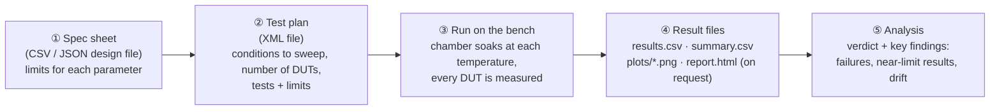
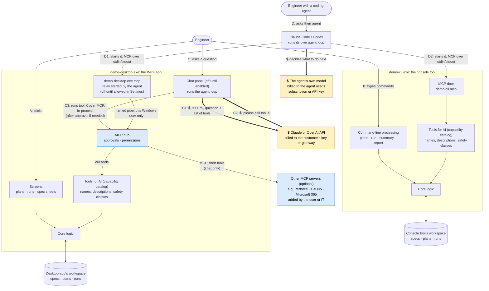
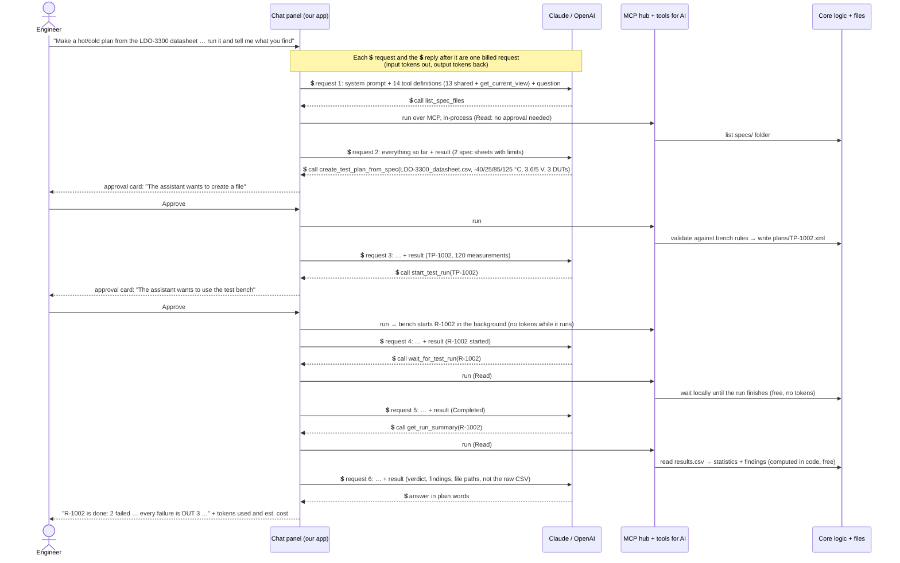
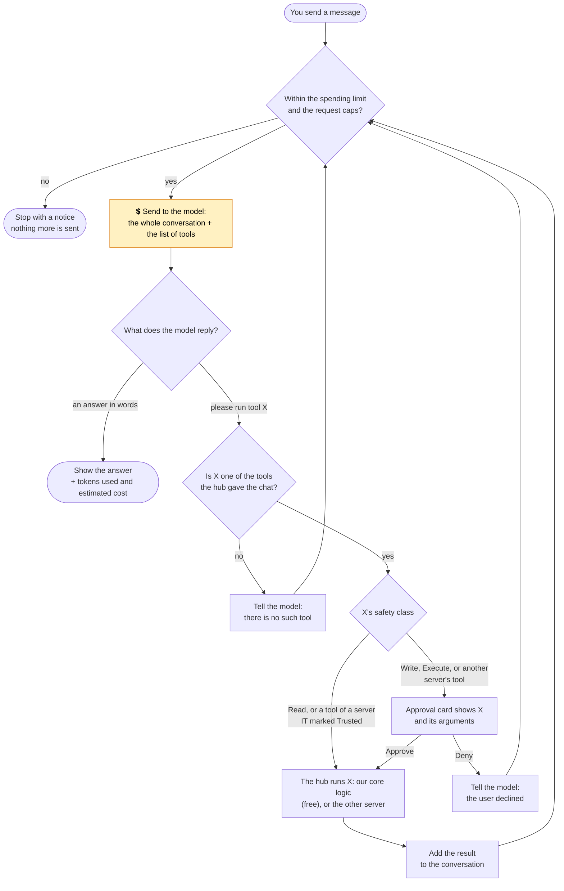
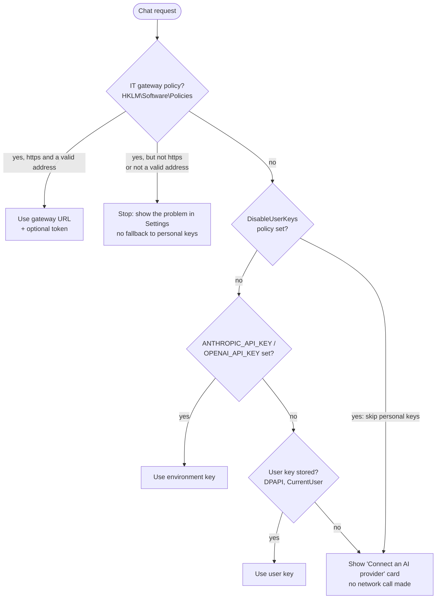
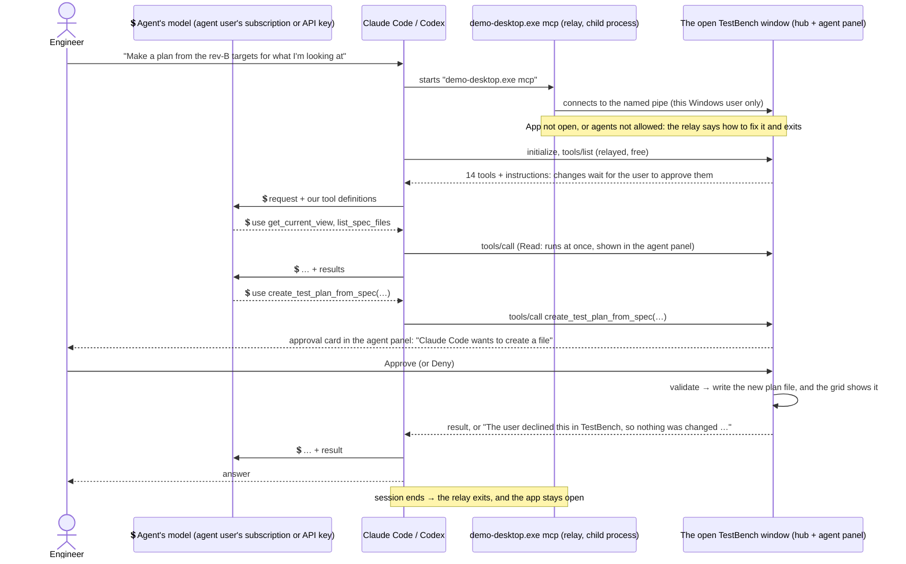
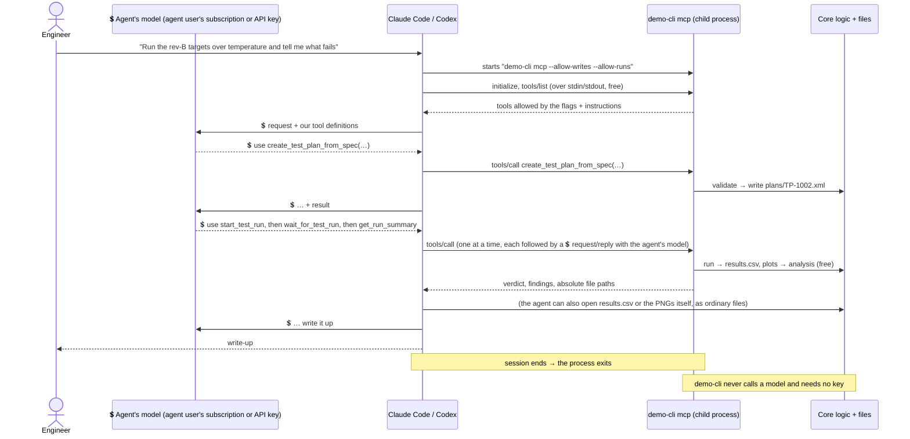
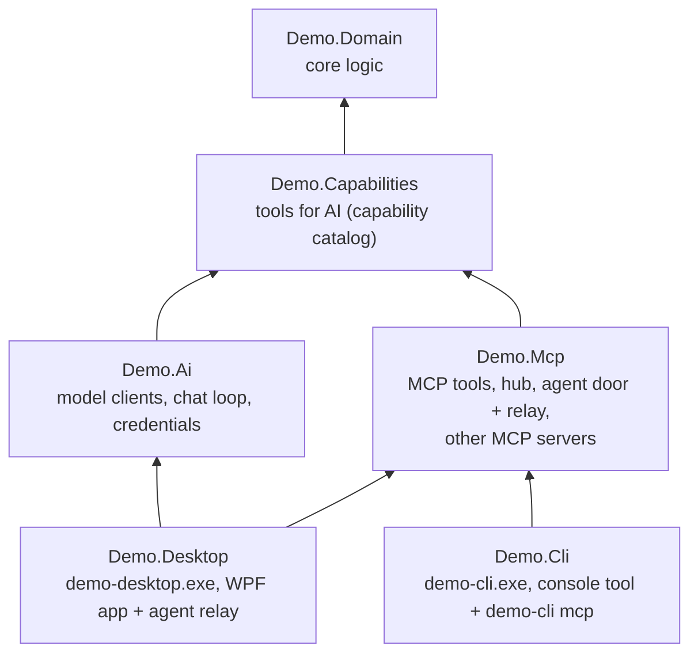

# Design: adding AI to a legacy desktop tool

This document explains how the demo is put together and why. If you only read one section, read [§3 Who calls what](#3-who-calls-what-the-runtime-picture).

**Contents**

1. [What we are demonstrating](#1-what-we-are-demonstrating)
2. [The pretend legacy tool: TestBench](#2-the-pretend-legacy-tool-testbench)
3. [Who calls what: the runtime picture](#3-who-calls-what-the-runtime-picture)
4. [Why each piece exists](#4-why-each-piece-exists)
5. [The tools for AI (capability catalog): one list of what AI may do](#5-the-tools-for-ai-capability-catalog-one-list-of-what-ai-may-do)
6. [Path C in detail: the chat assistant](#6-path-c-in-detail-the-chat-assistant)
7. [Path D in detail: coding agents over MCP](#7-path-d-in-detail-coding-agents-over-mcp)
8. [The MCP hub in the desktop app](#8-the-mcp-hub-in-the-desktop-app)
9. [The app does the work; the model orchestrates and explains](#9-the-app-does-the-work-the-model-orchestrates-and-explains)
10. [Security in one table](#10-security-in-one-table)
11. [Testing](#11-testing)
12. [Screenshots are generated, not taken by hand](#12-screenshots-are-generated-not-taken-by-hand)
13. [Build dependencies (compile time, not runtime)](#13-build-dependencies-compile-time-not-runtime)
14. [Open items](#14-open-items)

---

## 1. What we are demonstrating

We ship Windows desktop tools that run **on customer machines**. We want to show one workable way to let customers use AI with them, for two kinds of customer:

| Persona | Who they are | What they want | What we give them |
|---|---|---|---|
| **"Just let me ask it"** | Engineers and technicians. They don't know or care what Claude, Codex or MCP are. | Type "make a hot/cold plan from the datasheet and run it" and get it done, then ask questions about the results. | An **opt-in chat panel** in the desktop app. Through the app's **MCP hub** it can also use other MCP servers the user or IT adds (Perforce, GitHub, Microsoft 365…). |
| **"I have my own agent"** | Engineers who already use Claude Code, Codex or Cursor. | Have their agent drive our tool as part of bigger work, e.g. "run the rev-B targets over temperature and write up what fails". | Two MCP doors: into the **open desktop app** (`demo-desktop.exe mcp`, opt-in, changes approved in the window), and into the **console tool** (`demo-cli mcp`). |

Four constraints shape every decision:

1. **The customer pays for AI.** We never ship a vendor API key. The chat panel uses the customer's own key or their company's AI gateway; coding agents use their own subscription or API key.
2. **It runs on the customer's PC.** There is no backend of ours in the loop.
3. **Off by default.** A customer who never opts in sees no change and no network traffic, and no agent can connect to the desktop app.
4. **AI can only do what a person could do**, through the same validated code, and anything that changes data or acts on the outside world (here: creating files, starting the bench, using another MCP server) needs a person's OK.

## 2. The pretend legacy tool: TestBench

The two apps simulate a typical engineering test tool. It controls a test bench (a temperature chamber, a power supply, and meters) that measures voltage-regulator chips. Each chip on the bench is a **DUT** (device under test). The bench is simulated, but the workflow is the real one:


<sub>[Download this diagram as PNG](images/diagrams/design--the-pretend-legacy-tool-testbench.png)</sub> <!-- diagram-png -->

All state is **plain files in a workspace folder**, which is how real tools of this kind tend to work:

```
workspace\
  specs\   LDO-3300_datasheet.csv, LDO-3300_rev-B_targets.json   ← the customer's design files
  plans\   TP-1001.xml, TP-1002.xml, TestPlan.xsd                ← test plans
  runs\    R-1001\ run.json, results.csv, summary.csv, plots\*.png,
                   report.html (when requested: Write report button, generate_report or demo-cli report)
```

**The two apps are separate programs, each with its own workspace.** They stand for two different products, one with a UI and one for the command line, not one app in two forms, so they never share files or talk to each other.

- The desktop app uses `%LOCALAPPDATA%\ChatbotAddonDemo\workspace`, or the folder given by `--workspace`. Its `--demo` mode uses a throwaway workspace in `%TEMP%` unless `--workspace` is given, and ignores IT's policy, so the demo, the UI tests and the screenshots look the same on every PC.
- The console tool uses `%LOCALAPPDATA%\ChatbotAddonDemoCli\workspace`, or the folder given by `--workspace` or the `DEMO_WORKSPACE` environment variable.

Inside the desktop app every way in (the screens, the chat, a connected agent) uses the same bench service, so a plan or run made by any of them appears on screen within a moment.

The simulated bench produces realistic data: temperature drift, unit-to-unit spread, noise, and one weak unit (DUT 3) whose current draw runs away above 85 °C. That gives the analysis, and the AI, something real to find.

## 3. Who calls what: the runtime picture

There are **two separate programs** (`demo-desktop.exe` and `demo-cli.exe`) and **five ways in**: two that existed before AI (A and B) and three that the AI work adds (C, D1 and D2).


<sub>[Download this diagram as PNG](images/diagrams/design--who-calls-what-the-runtime-picture.png)</sub> <!-- diagram-png -->

**💲 marks every place tokens are spent.** The thick arrows are calls to a model; every other arrow is ordinary local code, process start-up or file access, and costs nothing.

### Reading the diagram

| Path | Who | What happens, step by step | AI involved? | Who pays for AI |
|---|---|---|---|---|
| **A** | Engineer at the desktop app | Clicks a button → the screen calls the core logic directly. *Unchanged legacy behavior.* | No | n/a |
| **B** | Engineer at a terminal or script | Types `demo-cli run TP-1001` → the command calls the core logic directly. *Unchanged legacy behavior.* | No | n/a |
| **C** | Engineer in the chat panel | **C1** 💲 the app sends the question and the list of tools to Claude/OpenAI. **C2** 💲 the model replies "call `create_test_plan_from_spec` with these arguments". **C3** the app shows an approval card if the tool creates files, uses the bench or belongs to another MCP server, then runs the tool through the MCP hub: our tools go through the tools for AI (capability catalog) to the core logic (free); another server's tools go to that server. The result goes back to the model, 💲 another billed request, and C1 to C3 repeat until it answers in words. | Yes, **our app** talks to the model | The customer, via their API key or gateway |
| **D1** | Engineer using Claude Code / Codex with the **open desktop app** | 💲 the agent asks its own model, which decides to use one of our tools. The agent starts `demo-desktop.exe mcp`, a small relay that passes its MCP messages over a named pipe to the open window's hub. Reads run at once; a change or bench action shows an approval card in the window and waits. The result goes back to the agent's model (💲 on the agent's side). Off until the user allows it in Settings. | Yes, but **only inside their agent**; our code never talks to a model | The agent user, via their own subscription or API key |
| **D2** | Engineer using Claude Code / Codex with the **console tool** | 💲 the agent asks its own model, which decides to use one of our tools. The agent starts `demo-cli mcp` as a child process and talks to it over stdin/stdout. The console tool runs the tool through the same tools for AI and core logic and replies (free). The process exits when the agent session ends. | Yes, but **only inside their agent** | The agent user, via their own subscription or API key. Our tool needs no key. |

### Where tokens are spent (and where they aren't)

| Activity | Calls a model? | Whose tokens | What drives the amount |
|---|---|---|---|
| Screens and `demo-cli` commands (paths A, B) | **No** | none | n/a |
| Bench runs, CSV/plot/report writing, analysis, validation | **No.** Ordinary code in Demo.Domain | none | n/a |
| The MCP hub, the agent relay and `demo-cli mcp` | **No.** Local messages between our own code, or between the agent and our code | none | n/a |
| 💲 One message in the chat panel (path C) | **Yes, usually several requests.** One per model↔tool round trip, e.g. 6 for the walkthrough in §6.1 | **The customer's** API key or company gateway | Each request resends the system prompt (the app's standing instructions to the model), the tool definitions and the whole conversation so far, so input tokens grow during a chat. Tool *results* count too, which is why the analysis tools return summaries rather than raw CSV (§9). Every tool from another MCP server adds its definition to every request. "New chat" starts from zero. |
| A tool from another MCP server, called for the chat | **Not by itself**, but its result goes to the chat's model in the next request | The customer's key or gateway, for that request | The size of what the other server returns |
| 💲 A coding agent using our tools (paths D1, D2) | **Our apps: never.** The *agent* calls its own model before and after every tool call | **The agent user's** own subscription or API key. We never see it or pay for it | The agent's own context; our tool descriptions and results are part of it, so short results help here too |
| 💲 "Test connection" in Settings | **Yes**, one tiny request, with the credential currently in use and the model typed in Settings | The customer's key or gateway | A few tokens |
| `--demo` mode, the screenshots, `dotnet test` | **No.** A scripted fake model replays the conversation; the tools still run for real | none | n/a |
| 💲 `DEMO_LIVE_TESTS=1` | **Yes**: a short chat per provider, then the walkthrough job with each provider, Claude Code and Codex | Whoever's keys are in the environment, and the agent users' accounts | Roughly $1 in all |

What the customer sees and controls: the panel shows tokens used and an estimated cost after every request; a per-chat limit (default $1.00) is checked *before* every request, including the automatic lookups within one message; and caps on round trips (8 between approvals, 20 requests per message) stop a confused model from looping. See §6.4.

### Things the diagram makes explicit

- **In the desktop app, every AI goes through the hub.** The chat panel is an MCP *client* of the hub (in-process, no port), a coding agent is another client (over the relay), and for other MCP servers the hub is the client. Approvals and permissions therefore live in one place, and the chat and agents get the same tools with the same descriptions.
- **The model never touches files or the bench.** In path C the model only *asks* for a tool by name; our app decides whether to run it (approval) and runs it. In paths D1 and D2 the same is true, with the agent in the middle.
- **Paths A and B don't go through the tools for AI**, and they don't need to. The catalog is the *AI-facing* adapter: tool names, descriptions written for models, JSON schemas, and safety classes. People already have their UI and commands. Every path ends in the same core logic, so the same rules (limits, ranges, "the bench runs one plan at a time") apply to everyone.
- **The two programs are separate.** Each contains its own copy of the catalog and the core logic (libraries compiled into each exe, not services) and has its own workspace. No arrow joins them.
- **Agents see only our tools.** The hub connects other MCP servers to the chat panel only; an agent that wants GitHub can connect to GitHub itself (§8.3).
- **Each AI feature is independent.** The chat panel, the agent door (D1), other MCP servers and `demo-cli mcp` (D2) can each be on or off.

## 4. Why each piece exists

### The two programs

| Program | What it's for | Why it exists in the demo |
|---|---|---|
| **demo-desktop.exe** (WPF) | The everyday tool: look at plans, run them, review results and plots. | The **chat assistant lives here** because this is where non-technical users already are. It also knows what the user is looking at (`get_current_view`), so "analyze this run" works. Its **MCP hub** lets a coding agent work with the window the user has open (D1), with changes approved there, and connects the chat to other MCP servers. See [ADR-007](adr/007-mcp-hub-in-the-desktop-app.md). |
| **demo-cli.exe** (console) | Scripted and batch work, e.g. nightly runs or CI. | **Coding agents can connect here too** (`demo-cli mcp`, D2). An agent starts it on demand: no app needs to be open and no one needs to be there to approve, so it suits unattended work; what it may do is set by flags. There is **no chat** in the console tool: its users automate, and their AI is the agent. See [ADR-005](adr/005-no-chat-in-cli.md). |

### The libraries inside them

| Library (project) | Responsibility | Used by | Why it's a separate piece |
|---|---|---|---|
| **Demo.Domain**, the "core logic" | Plans (XML + schema + validation), spec-sheet import, the simulated bench, result files, plots, analysis, report. **Knows nothing about AI.** | Both programs | It's the legacy tool's core. Every way in ends here, so the rules are enforced once. |
| **Demo.Capabilities**, the "tools for AI" (capability catalog) | The list of what AI may do: 13 shared tools (the desktop app adds a 14th, `get_current_view`), each with a model-facing description, typed parameters (which become the JSON schema) and a safety class (Read / Write / Execute). | Both programs | Defined **once** and used by the chat panel, the hub and both MCP doors. Without it, chat tools and MCP tools would be written twice and drift apart. See [ADR-001](adr/001-capability-layer.md). |
| **Demo.Mcp** | Everything MCP: turning the catalog into MCP tools with annotations (`McpToolAdapter`), the hub (`McpHub`), the agent door on a named pipe (`AgentDoor`) and the relay behind `demo-desktop.exe mcp` (`AgentRelay`), other MCP servers (`OutsideServer`), and turning MCP tools back into catalog entries for the chat (`McpCapabilities`). | Both programs (the console tool uses only `McpToolAdapter`) | One MCP layer on top of the official MCP SDK, so both doors serve the same tools the same way. **Never calls a model.** |
| **Demo.Ai** | Talking to Claude/OpenAI (`IChatClient`), the chat loop with approvals, credentials (DPAPI, gateway, env var), cost meter, settings and IT policy. | Desktop app only | Everything about *our app calling a model*. The console tool doesn't reference it, because it never calls a model. |

## 5. The tools for AI (capability catalog): one list of what AI may do

Each capability is a C# method with an attribute:

```csharp
[Capability("start_test_run", SafetyClass.Execute, Title = "Start a run on the bench")]
[Description("Starts running a plan on the bench and returns the new run id at once. ...")]
public object StartTestRun([Description("Plan id, e.g. 'TP-1002'.")] string planId) => ...
```

From that one definition we get an `AIFunction` (works with any `IChatClient`) and an MCP tool (`McpServerTool.Create`). The chat panel gets its tools *through the hub*, as MCP tools turned back into catalog entries, so it sees exactly what an agent sees. The **safety class** decides how each front end treats a tool:

| Safety class | Capabilities | Desktop app: chat panel and agents (D1) | Console tool (D2) | MCP annotations |
|---|---|---|---|---|
| **Read**: only looks | `get_bench_info`, `list_spec_files`, `list_test_plans`, `get_test_plan`, `list_test_runs`, `wait_for_test_run`, `get_run_summary`, `query_measurements`; plus `get_current_view` (desktop app only) | Runs automatically; shown as a "⚙ …" line in the chat or in the agent panel. Exception: a lookup the chat's model asks for in the same step as a change also gets an approval card ("The assistant wants to look something up") | Always available | `readOnlyHint: true`, `idempotentHint: true` |
| **Write**: creates or changes files | `create_test_plan`, `create_test_plan_from_spec`, `generate_report` | **Approval card** ("The assistant wants to create a file", or "Claude Code wants to create a file") | Only with `--allow-writes` | `readOnlyHint: false`; `idempotentHint: true` for `generate_report` only |
| **Execute**: acts on the outside world (here, the bench hardware) | `start_test_run`, `cancel_test_run` | **Approval card** ("… wants to use the test bench") | Only with `--allow-runs` | `readOnlyHint: false`, `openWorldHint: true`; `destructiveHint: true` for `cancel_test_run` only |
| *(another MCP server's tool, chat only)* | e.g. `github_search_issues` | **Approval card** ("The assistant wants to use github"), unless IT marked the server Trusted | n/a | Not trusted (§8.3) |

The MCP annotations are hints the coding agent uses for its own permission prompts: `readOnlyHint` = only looks; `idempotentHint` = calling it twice with the same inputs has no extra effect; `openWorldHint` = affects things outside the app (here, the bench); `destructiveHint` = may destroy work (a cancelled run's remaining measurements are never taken). All four hints are set on every tool, true or false; creating plans and starting runs always make new files, so they are not destructive. The hub reads the safety class of *our* tools back from these annotations; it ignores the annotations of other servers' tools, because whoever wrote that server chose them.

Write and Execute are separate because they carry different risks. A wrong plan file costs nothing; a wrong bench run ties up shared hardware for hours in real life. An admin might allow an agent to draft plans but not run them.

Business-rule errors ("Temperature 200 °C is outside the bench range -55 to 150 °C") come back to the model as readable results, not exceptions, so it can correct itself or explain the problem to the user. They read the same with or without the hub in between.

## 6. Path C in detail: the chat assistant

The model decides, the loop drives, the hub controls access. The model only ever answers with text or "please run tool X". `ChatSession` is the loop: it sends the question with the list of tools, runs each tool the model asks for (through the hub, which asks the user first where needed), sends the result back, and repeats until the model answers in plain text (or a per-message request limit or the spending limit stops it). On path D the coding agent runs that same loop itself, and only the hub's part happens in our app.

### 6.1 One conversation, step by step

This is the scripted conversation in the screenshots: the user asks for a plan from the datasheet, has it run, and wants the findings.


<sub>[Download this diagram as PNG](images/diagrams/design--one-conversation-step-by-step.png)</sub> <!-- diagram-png -->

**This one message costs 6 billed requests** (6 request/reply pairs). Each one resends the system prompt, the tool definitions and the conversation so far, so later requests have more input tokens than earlier ones. The demo script reports illustrative counts of about 21,000 input and 450 output tokens for this message: roughly $0.09 at Claude Opus 5.5 prices, or $0.05 at Sonnet 5.5 prices. Real counts depend on the model and the conversation. The waiting, the bench run, the analysis and the hub cost nothing; they happen in our code.

- If the user clicks **Deny**, the tool doesn't run and the model is told "the user declined", so it can suggest something else.
- The screens use the same bench service as the hub's tools, so the grids update and the Runs tab switches to the run in progress.

**The same thing as rules.** The sequence above is one example. This is what happens for every message, whatever the model asks for:


<sub>[Download this diagram as PNG](images/diagrams/design--one-conversation-step-by-step-2.png)</sub> <!-- diagram-png -->

- The model never runs anything. It can only reply with words or with a request to run a tool; our code decides what happens next.
- A Read tool asked for in the same reply as a change gets an approval card of its own ("The assistant wants to look something up") rather than running silently.
- The caps are 8 round trips between approvals and 20 model requests per message (§6.4).
- In code: the loop is Microsoft's `FunctionInvokingChatClient`, which runs Read tools itself and stops at approval-required ones. `ChatSession` shows the card, adds the decision and calls it again. The spending check is `MeteringChatClient`, which sits inside the loop so it sees every request. The tools it is given come from `McpHub.ConnectChatAsync`; `ChatSession` doesn't know they arrived over MCP.

### 6.2 Provider abstraction

The chat code uses **`Microsoft.Extensions.AI.IChatClient`**, Microsoft's provider-neutral chat interface. Both vendors' official SDKs provide one:

- Anthropic: `new AnthropicClient { ApiKey = … }.AsIChatClient("claude-opus-5-5")`
- OpenAI: `new OpenAIClient(key).GetResponsesClient().AsIChatClient("gpt-6-astra")`, the Responses API (OpenAI's newer endpoint) with `store: false` (OpenAI keeps no copy of the conversation; see [ADR-002](adr/002-provider-abstraction.md))

The tool loop (`FunctionInvokingChatClient`), approvals (`ApprovalRequiredAIFunction`), metering, the hub and the UI are provider-neutral. Adding another provider (Azure OpenAI, Bedrock, a local model) means a new `AiProvider` value, a `ProviderInfo` entry (display name, default model, key variable) and one case in `ChatClientFactory`, plus a choice in the Settings dialog (which has two radio buttons today) and, for cost limits in dollars, its prices in `PriceTable`. See [ADR-002](adr/002-provider-abstraction.md).

### 6.3 Credentials: the customer pays


<sub>[Download this diagram as PNG](images/diagrams/design--credentials-the-customer-pays.png)</sub> <!-- diagram-png -->

Read it top to bottom. The app uses the first source that is configured:

1. **Company AI gateway.** IT sets a base URL (and optionally a token) by Group Policy. Requests go to *their* proxy (e.g. LiteLLM or Azure API Management), which holds the real vendor key and enforces budgets and logging. Desktops hold no vendor key at all. **This is what we recommend to larger customers.** If a gateway value is present but unusable (not https, or not a valid address), the app says so and stops there: it never falls back to personal keys.
2. **Environment variable**, for scripted rollouts.
3. **The user's own key**, pasted in Settings, encrypted with Windows DPAPI for that Windows user only, never written to config or logs, and removable with one click.

If IT sets the `DisableUserKeys` policy, steps 2 and 3 are skipped: only a gateway can be used. When no gateway is set, the app always uses the provider's official address, so environment variables such as `ANTHROPIC_BASE_URL` can't redirect a key somewhere else. The app also gives the vendor SDK its credential explicitly, because the Anthropic SDK otherwise adds any it finds itself (`ANTHROPIC_AUTH_TOKEN`, a saved `ant auth login` profile) to every request, gateway requests included.

What we deliberately **don't** do: ship our own key in the binary (anyone could extract it, and we would pay for everyone), or ask users to paste keys into a config file. See [ADR-003](adr/003-credential-handling.md).

None of this applies to coding agents (D1, D2): they bring their own model and account, and our apps never see them.

### 6.4 Cost visibility and limits

💲 Every model request in path C is billed to the customer, so they get to see and limit it:

- Each response reports input and output tokens, and they're added to the chat's total as soon as that request finishes. The panel shows the running total and an *estimated* cost, from a small price table per model.
- An optional per-chat limit (default $1.00) is checked **before every request**, including the automatic tool round trips inside one message. The app adds a projected cost for the next request to what the chat has spent so far and doesn't send it if the total would go over. The projection is an estimate: for input, the larger of the previous request's input tokens and a rough count of the messages about to be sent (characters ÷ 4), so even the first request can be refused; plus 1,000 output tokens. The final total can therefore land above or below the limit: at worst, one unusually long reply goes over by the cost of one maximum-length reply (16,000 output tokens, about $0.32 on Opus 5.5).
- **Models with no known price** (currently all OpenAI models, because we don't ship prices we haven't verified) get a **token limit** instead: 500,000 tokens per chat by default. The usage line says so, e.g. "84,000 tokens (limit 500k tokens; no price known for gpt-6-astra)". Turning the limit off in Settings turns both off.
- Two caps stop a confused model from looping on the customer's bill: at most 8 model↔tool round trips between approvals, and at most 20 model requests per message in total. Hitting either ends the message with a notice instead of spending more.
- The limit box in Settings accepts only a dollar amount above zero (e.g. `1.50`, optionally with `$`) or empty for no limit; anything else is refused with "Enter a dollar amount above zero, such as 1.50, or leave the box empty for no limit." and Save stays disabled, so a typo can't silently remove the limit.

Design choices that keep the bill down:

- Tools return **summaries, not raw data** (§9). A run summary is a few hundred tokens; its raw CSV would be tens of thousands, resent on every later request.
- **New chat** drops the history, so the next request starts small again.
- The model is a setting, so a customer can choose a cheaper one (e.g. Sonnet or Haiku instead of Opus).
- Other MCP servers are optional. Each one's tool definitions are sent with every request, so a server with many tools makes every request bigger.
- Not done yet: prompt caching for the system prompt and tool definitions, which are identical on every request (§14).

## 7. Path D in detail: coding agents over MCP

A coding agent can work with either program, and the two doors suit different work:

| | **D1: the open desktop app** | **D2: the console tool** |
|---|---|---|
| The agent starts | `demo-desktop.exe mcp`, a relay to the open window | `demo-cli mcp`, which does the work itself |
| Needs | TestBench open, and "Let coding agents connect" on in Settings | Nothing open |
| Works on | The desktop app's workspace, and what the user is looking at (`get_current_view`) | The console tool's workspace |
| Changes and bench use | Each one waits for the user's OK on an approval card in the window | Allowed or not by `--allow-writes` / `--allow-runs`, chosen when connecting |
| Good for | Working *with* someone: they watch the agent's plans and runs appear and approve each change | Unattended or scripted work |

Both serve the same tools with the same descriptions and annotations (`McpToolAdapter`), and neither ever calls a model. Setup snippets for Claude Code and Codex: [guides/connecting-a-coding-agent.md](guides/connecting-a-coding-agent.md).

### 7.1 D1: working with the open app


<sub>[Download this diagram as PNG](images/diagrams/design--d1-working-with-the-open-app.png)</sub> <!-- diagram-png -->

- **Off until the user allows it.** "Let coding agents connect" in Settings opens the door; IT can keep it closed (`DisableAgentConnections`). The agent panel above the chat shows how many agents are connected, what they ran, and their approval cards.
- **The same approval card as the chat**, with the agent's own name ("Claude Code wants to use the test bench"). If the user declines, the agent is told so and asked not to retry. If the agent gives up while a card is waiting, the card is withdrawn.
- **No network port.** The door is a named pipe that only the same Windows user can open and that refuses connections from other computers; the relay only connects to a pipe its own user created (§8.2).
- **One window at a time.** If a second TestBench window is opened, only the first lets agents in; the second says so in its agent panel.

### 7.2 D2: the console tool


<sub>[Download this diagram as PNG](images/diagrams/design--d2-the-console-tool.png)</sub> <!-- diagram-png -->

- **No key in our tools, and no tokens on our side** (D1 and D2). Every 💲 arrow is between the agent and its own model, on the agent user's subscription or API key; as in §6.1, a 💲 request and its reply are one billed request. Our tool results become part of the agent's conversation, so they go to the agent's AI provider under the agent user's terms. The MCP traffic between the agent and our programs is free local I/O.
- **What the agent may do through `demo-cli mcp` is set by whoever configures it.** `demo-cli mcp` alone exposes only Read tools; `--allow-writes` adds the Write tools (plans and reports); `--allow-runs` adds the Execute tools (the bench). The agent's own permission prompts also apply, using the tool annotations.
- **Why MCP if the agent could just run `demo-cli` commands in a shell?** It can, and that's fine. MCP adds typed tools with descriptions, structured results (no screen-scraping of console output), the same safety classes (Read / Write / Execute) as the chat panel, readable errors that name a bad argument, and it works in agents that have no shell.
- **Why the console tool has no hub of its own:** its only AI is the coding agent, and the agent can already connect to Perforce, GitHub or any other MCP server itself. A hub there would add nothing.

## 8. The MCP hub in the desktop app

The hub (`McpHub`, in `Demo.Mcp`) is the desktop app's one door for every AI. Why it exists, and what it replaced (agents only through the console tool), is in [ADR-007](adr/007-mcp-hub-in-the-desktop-app.md).

### 8.1 The chat panel's connection (C3)

When a chat starts, `McpHub.ConnectChatAsync` gives the chat panel its tools:

- **Our tools** come over a real MCP connection inside the process: an MCP server and client joined by in-memory pipes, with no process and no port. The chat gets them back in the catalog's order, as catalog entries, with their safety class read back from the annotations. Their results are unwrapped from MCP's envelope, so the model reads exactly what it would read without the hub.
- **Other servers' tools** come from each server the user or IT added, named with the server first (`github_search_issues`), so two servers' `search` tools can't clash, and kept to what every provider accepts in a tool name. The servers are connected side by side, so the slowest one sets the wait. A server that can't be reached within 30 seconds, or whose entry is unusable, is skipped and named in the chat as a notice: one broken server never stops the chat. So is a single tool whose inputs a provider would refuse (inputs that aren't an object, `anyOf`/`oneOf`/`allOf`/`not`/`enum` at the top, or a list that doesn't say what it holds): every tool goes out with every message, so one refused tool would fail every message, not just itself.

This connection has no approval gate of its own, because the chat session asks the user before every call that needs it (§6.1).

### 8.2 The agent door (D1)

`AgentDoor` listens on a **named pipe**, one name per Windows account (`ChatbotAddonDemo.TestBench.<the account's SID>`), and serves each connected agent the same tools through an approval gate: reads run at once, everything else waits for `IAgentSupervisor.ApproveAsync`, which the agent panel shows as a card. `demo-desktop.exe mcp` is the relay (`AgentRelay`): it copies the agent's stdin/stdout to the pipe and back, so to the agent it looks like any other stdio MCP server.

Why a named pipe and a relay, not an HTTP server on `127.0.0.1`: a listening port has to be secured against every program and web page on the PC (bearer tokens, Host/Origin checks against DNS rebinding, token rotation). The pipe gets the same protection from Windows:

- Its access list allows only the current Windows user and denies network logons, so other users and other computers can't connect.
- The relay checks that the pipe is owned by its own Windows user before talking to it, so it never talks to a pipe another user set up to listen in. (It checks the owner itself rather than using `CurrentUserOnly`, which compares against the Administrators group for a program run as administrator, and so would refuse whenever the app and the agent differ in elevation.)
- Only the first window can open the pipe name (`FirstPipeInstance`), so a second copy of the app reports the clash instead of sharing it.
- The door is open only while the setting is on and the app is running; turning it off disconnects every agent.

### 8.3 Other MCP servers

Users add servers in Settings ("Other MCP servers for the assistant"); IT adds them by policy under `HKLM\Software\Policies\ChatbotAddonDemo\McpServers\<name>` (`Command`, `Trusted`). Each entry is a name and either a command line that starts the server (spoken to over its stdin/stdout) or the address of a remote server. The rules:

| Rule | Why |
|---|---|
| **Every tool from another server needs approval**, whatever its annotations say | Its read-only hints were written by whoever made that server; we can't check them |
| **Only IT can mark a server Trusted**, so its tools run without asking | A trust decision about an outside system belongs to the organization, not to whoever edits Settings |
| **IT's servers come first**; a user's entry can't take an IT server's name | So a user can't replace a server IT set up |
| **IT can turn off users' own servers** (`DisableUserMcpServers`) | Some organizations allow only the servers they chose |
| **Remote servers must use https**; plain http is allowed only to this PC | The connection can carry the user's work and credentials |
| **Agents never see these tools** | An agent can connect to those servers itself, with its own credentials and permission prompts; the hub's outside connections are the chat's |

Like our own tools, what another server returns goes to the chat's model in the next request, so adding a server means its data can leave the PC through the chat (see [security.md](security.md)).

## 9. The app does the work; the model orchestrates and explains

Two rules make the AI features trustworthy, and they are the most reusable lesson of this demo. See [ADR-006](adr/006-model-orchestrates-app-computes.md).

1. **The model never writes the plan file.** It calls `create_test_plan_from_spec` or `create_test_plan` with structured arguments. Our code builds the XML, validates it against `TestPlan.xsd` and the bench's rules (ranges, units, known measurements, fixtures, size), and saves it. When a datasheet is the source, limits are copied from the file and never retyped by the model.
2. **The model never does the statistics.** `get_run_summary` and `query_measurements` compute verdicts, Cpk (a standard process-capability index), drift and worst cases in code, and return findings as sentences. The model chooses *which* analysis to run (e.g. "only 125 °C, only DUT 3") and explains the result. Raw CSV data never goes through the model, which also keeps token costs down.

## 10. Security in one table

| Risk | Mitigation |
|---|---|
| API key stolen from disk | DPAPI (current Windows user) encryption; never in config or logs; the gateway option keeps keys off desktops entirely |
| Model does something the user didn't want (mistake, or prompt injection hidden in a spec sheet or another server's results) | Read tools only, unless a person approves each Write/Execute call or other-server call; all calls go through bench validation; the catalog is the boundary (there is no "run any command" tool) |
| Model reads arbitrary files | Spec sheets are read by bare file name from the workspace's `specs` folder only |
| Runaway spend | Round-trip and per-message request caps, per-chat limit checked before every request (dollars, or tokens for unpriced models), visible meter |
| Agent misuse of the open app (D1) | Off until the user allows it, and IT can block it; every change waits for the user's approval in the window; named pipe for this Windows user only, no network listener |
| Agent misuse through `demo-cli mcp` (D2) | Read-only by default; `--allow-writes` and `--allow-runs` are separate; stdio means no network listener |
| Another MCP server misbehaves | Its tools always ask first unless IT trusts the server; its annotations are ignored; https only; IT can limit the list to its own servers; agents can't reach it through us |
| Data leaving the PC unexpectedly | Chat is opt-in, with a plain-language disclosure; nothing is sent until the user enables it and sends a message. Other servers' results join the chat's conversation. In paths D1 and D2 our tool results go to the agent's AI provider under the agent user's terms; our apps never call a model for agents |

Details: [security.md](security.md).

## 11. Testing

| Project | What it covers | Network or key? |
|---|---|---|
| `Demo.Domain.Tests` | Seeding, plan XML round-trip and schema, bench rules, spec import and path restriction, the weak-unit finding, filtered analysis, determinism, one-run-at-a-time, cancel, crashed-run detection, report, import | No |
| `Demo.Capabilities.Tests` | Catalog contents and safety classes, schemas, plan→run→analyze through the capabilities, errors returned as results, Read tools never change files | No |
| `Demo.Ai.Tests` | Chat loop with a **scripted fake model**: auto-run reads, approval for Write and Execute, denial, cost metering, spend cap, system prompt composition; credential precedence and DPAPI, https-only gateway, settings for agents and other MCP servers, OpenAI response storage off, invented tool names refused | No |
| `Demo.Ai.Tests` (Live) | 💲 One short chat (a few requests) per provider. **Skipped unless `DEMO_LIVE_TESTS=1`**, because developers often have keys in their environment and that alone must not spend money | Yes, opt-in |
| `Demo.Mcp.Tests` | The hub: the chat gets the same tools, in the same order, with readable results and errors; changes happen in the app; other servers' tools are prefixed and need approval unless trusted; an unreachable server is skipped and named. The agent door: every tool with its annotations, reads without asking, a change waits and runs once approved, a denied change creates nothing, several agents counted, a second app can't open the same door, closing ends every conversation, and the real relay reaches the app or says what to do. Server lists: IT first, only IT trusts, IT can turn off users' servers, entries checked | No |
| `Demo.Cli.Tests` | Starts the real `demo-cli mcp` like an agent does: tool list per `--allow-…` flag, annotations, plan→run→analyze over MCP, files on disk, readable errors for bad arguments, the run cancelled when the agent disconnects; plain commands: command-line parsing and exit codes 0/1/2 | No |
| `Demo.Paths.Tests` | **One job, every path**: the walkthrough job (plan from the datasheet, run, findings) done on the command line (B), in the chat through the hub (C), through the real `demo-desktop.exe mcp` relay into the hub (D1) and over `demo-cli mcp` (D2) must give the same plan and findings; within each app, what an agent makes the screens, chat or command line see. Path C goes through IT's gateway policy, the real Claude and OpenAI SDKs and real HTTP to a **fake AI gateway** on 127.0.0.1 with a scripted model, checking approvals, the gateway token on every request, the whole conversation resent, no empty messages, OpenAI storage off, Deny, and the spending limit | No |
| `Demo.Paths.Tests` (Live) | 💲 The same job with real Claude and OpenAI in the chat, and with real Claude Code and Codex over `demo-cli mcp`, each compared with the command-line result, plus a follow-up question to real Claude after an approved change (the second request must be accepted and answered from the conversation). The Claude chat and Claude Code stop at $0.50 each, the OpenAI chat (no known price) at 200,000 tokens; Codex has no spending option, so its run is limited to 5 minutes. Each test skips itself if its key (`ANTHROPIC_API_KEY`, `OPENAI_API_KEY`) or agent (`claude`, `codex` on PATH, or `DEMO_CLAUDE_EXE` / `DEMO_CODEX_EXE`) is missing. **Skipped unless `DEMO_LIVE_TESTS=1`** | Yes, opt-in |
| `Demo.Desktop.UiTests` | Drives the real WPF app with UI Automation: no AI without opt-in, opt-in flow, Settings for agents and other MCP servers, legacy run button, approve→plan+run+findings, deny→nothing created; a coding agent through the real relay works with the open window and is asked there first, is told when the user declines, and can't connect without opt-in | No |

The UI tests and the screenshot tool open the app **off-screen, without activating it and without a taskbar button**, and drive it through UI Automation patterns (no mouse or keyboard). They never interrupt whoever is using the PC. Each one gives its app copy its own agent pipe name (`--agent-pipe`), so a test agent never meets the TestBench the user has open.

GitHub Actions (`.github/workflows/build.yml`) builds everything and runs the free test projects on every push to main and every pull request. It never runs the paid tests (no keys are available there) or the UI tests (they need an interactive desktop).

## 12. Screenshots are generated, not taken by hand

`scripts/capture-screenshots.ps1` builds the solution and runs `tools/Demo.Screenshots`, which:

1. Starts the desktop app in `--demo` mode: a fresh example workspace and a **scripted model** that replays the conversation in §6.1. The tools still run for real (real plan file, real bench run, real findings), and the scripted replies are built from the real tool results, so the numbers always match. No key, no network.
2. Clicks through the walkthrough with UI Automation and asks the app to **render its own window to PNG** over a per-user named pipe (WPF `RenderTargetBitmap`). This works off-screen, with the screen locked, and on build agents, and gives identical images on every machine.
3. Turns on agents in Settings, then connects an MCP client through the real `demo-desktop.exe mcp` relay, standing in for Claude Code, and captures its approval card.
4. Runs real `demo-cli` commands and a real `demo-cli mcp` session, and renders their output as terminal-style images.
5. Copies one real output plot from the run.

The diagrams are Mermaid text, which GitHub draws in the browser. `node scripts/render-diagrams.mjs` renders each one to `docs/images/diagrams` (headless Chrome or Edge) and keeps the "Download this diagram as PNG" link under it, for pasting into slides or documents. Run it after editing a diagram.

## 13. Build dependencies (compile time, not runtime)

This shows **which project references which library** when building. It is *not* a picture of calls at runtime; §3 is.


<sub>[Download this diagram as PNG](images/diagrams/design--build-dependencies-compile-time-not-runtime.png)</sub> <!-- diagram-png -->

Arrows point from a project to the library it uses. The console tool has no path to `Demo.Ai`, which is how you can tell it never calls a model; neither does `Demo.Mcp`, so the hub can't either.

## 14. Open items

- **Prompt caching.** The system prompt and the 14 tool definitions (plus any other servers' tools) are resent unchanged on every request; caching them would cut input cost noticeably on long chats.
- **Streaming replies** in the chat panel. Answers are short today; streaming needs care around approval cards.
- **Approval cards show raw arguments.** A capability could supply a human summary, e.g. "120 measurements, about 5 s of bench time", computed by the app rather than the model.
- **MCP progress notifications** for long runs, instead of `wait_for_test_run` polling.
- **Signing in to other MCP servers.** Remote servers are reached without OAuth today, so only servers that need no sign-in, or local servers that handle their own, work; a real product needs the MCP authorization flow and a place to keep the tokens.
- **Choosing which agents may connect.** Any program the same Windows user runs can start the relay; the per-call approval is the safeguard. A product might show the agent's name for a first-time OK.
- Per-capability policy set by IT (e.g. "agents may never run the bench"), and an audit log of AI-initiated actions.
- A "sign in with provider" flow instead of raw keys, if vendors offer one suitable for third-party desktop apps.
- Known small gaps from the code review, left as-is for the demo:
  - The run heartbeat is written after each measurement. A real soak or measurement longer than 15 s would need a timer, or another process could mark a live run *Interrupted*.
  - Analysis uses the plan file as it is now. Snapshotting the plan into the run folder would protect against later edits.
  - The Cpk warning can fire on spread caused by sweeping supply voltage or only two temperatures.
  - Spec CSV parsing doesn't handle quoted commas.
  - The analysis tools have no load-current filter.
  - The gateway token is a plain registry value that any local user can read; prefer identity-based gateways.
