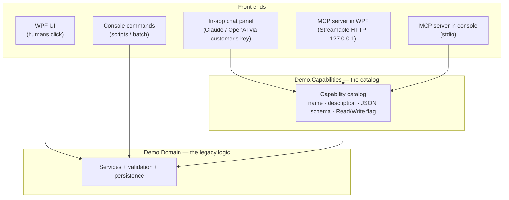
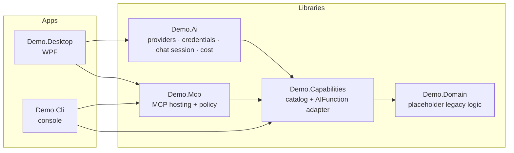
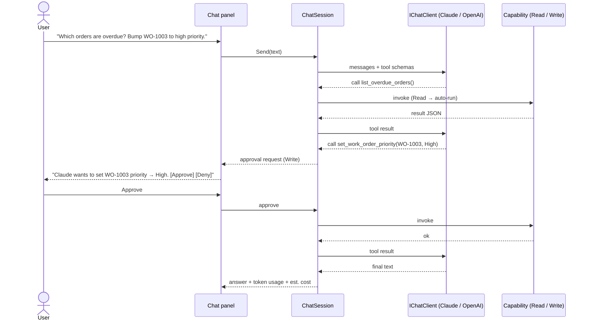
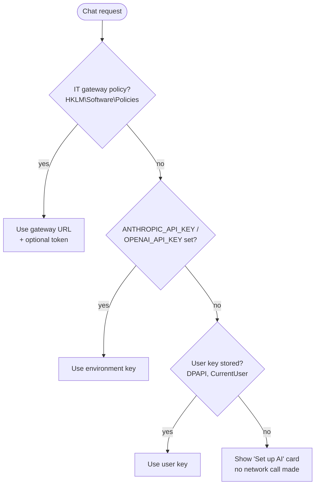

# Design: adding AI to a legacy desktop tool

> Status: **draft v0.1** (2026-10-12). The sample domain is a placeholder until the real tool shape is described; everything outside `Demo.Domain` is domain-agnostic.

## 1. What we are demonstrating

We ship Windows desktop tools (a WPF app and a console app) that run **on customer machines**. We want to show the *right* way to let customers use AI with them, for two kinds of customer:

| Persona | Who they are | What they want | What we give them |
|---|---|---|---|
| **"Just let me ask it"** | Operators, analysts; no idea what Claude/Codex/MCP are | Type a question in plain English, get an answer or have the tool do the thing | An **opt-in chat panel** inside the WPF app |
| **"I have my own agent"** | Engineers, automation folks, already use Claude Code / Codex / Cursor | Drive our tool from their coding agent, script against it | An **MCP server** in both the WPF and console apps |

Constraints that shape everything:

1. **The customer pays for tokens.** We never ship a vendor key. The customer supplies credentials, and we must store them safely on their machine.
2. **It runs on the customer's desktop**, not our cloud. No backend of ours is in the loop.
3. **Off by default.** AI features must be explicitly enabled; a customer who never opts in sees no behavior change and no network traffic.
4. **The AI can only do what the user could do**, through the same validated code paths, and writes need a human's OK.

## 2. The core idea: one capability catalog, three front ends

The naïve approach is "bolt a chatbot onto the UI" — let the model click buttons or scrape screens. That's brittle, untestable, and impossible to expose to external agents. Instead we pull the tool's operations into a **capability layer** and put three front ends on it.



Each capability is defined **once**: a name, a model-facing description, typed parameters (→ JSON schema), and a **safety class** (`Read` or `Write`). From that single definition we derive:

- a `Microsoft.Extensions.AI` **`AIFunction`** for the in-app chatbot (works with any `IChatClient` — Anthropic or OpenAI),
- an **MCP tool** (`McpServerTool.Create(aiFunction)`) with `readOnlyHint`/`destructiveHint` annotations,
- the test surface: one test suite proves the capability; the front ends are thin adapters.

**Why this matters for the demo audience:** adding a new capability lights it up in the chat panel *and* for external agents with zero extra work, and the AI never bypasses the business rules the UI uses.

See [ADR-001](adr/001-capability-layer.md).

## 3. Component map



| Project | Responsibility | Notable dependencies |
|---|---|---|
| `Demo.Domain` | The "legacy" logic. Knows nothing about AI. **Placeholder — will be replaced by a domain that mirrors our real tools.** | none |
| `Demo.Capabilities` | Catalog of capabilities over the domain; safety classes; conversion to `AIFunction` | `Microsoft.Extensions.AI.Abstractions` |
| `Demo.Ai` | `IChatClient` factory for Anthropic + OpenAI, credential storage (DPAPI), chat session with tool approval, usage/cost meter, scripted fake client for tests/demos | `Anthropic`, `OpenAI`, `Microsoft.Extensions.AI(.OpenAI)` |
| `Demo.Mcp` | Registers the catalog as MCP tools, applies exposure policy (read-only vs read-write), stdio and HTTP hosting helpers, bearer-token check | `ModelContextProtocol(.AspNetCore)` |
| `Demo.Desktop` | WPF app; Settings → AI page; chat side panel; MCP toggle + "copy config" | all of the above |
| `Demo.Cli` | Console app; normal commands; `mcp` subcommand runs a stdio MCP server | `Demo.Mcp` |

## 4. The in-app chatbot (persona 1)

### 4.1 Provider abstraction

We build on **`Microsoft.Extensions.AI.IChatClient`**, the .NET-standard chat abstraction. Both vendors' official SDKs ship an adapter:

- Anthropic: `new AnthropicClient { ApiKey = … }.AsIChatClient("claude-opus-5-5")`
- OpenAI: `new OpenAIClient(key).GetChatClient("gpt-6-astra").AsIChatClient()`

Everything above that line — tool calling, approval, usage metering, the UI — is provider-neutral. Adding a third provider (Azure OpenAI, Bedrock, a local model) is one factory case. See [ADR-002](adr/002-provider-abstraction.md).

**Trade-off we accept:** the abstraction exposes the common subset. Vendor-specific features (Anthropic prompt caching, effort levels; OpenAI reasoning options) are reachable via `ChatOptions.RawRepresentationFactory` per provider when we want them, without leaking into the UI.

### 4.2 Conversation loop with human approval



- `Read` capabilities run automatically; `Write` capabilities are wrapped in `ApprovalRequiredAIFunction` and surface an approval card. Denials are fed back to the model as a refusal so it can explain or adjust.
- A per-conversation **iteration cap** and an optional **spend cap** stop runaway loops on the customer's dime.
- Every tool call is shown in the transcript (collapsed by default) — the user can see exactly what the AI did.

### 4.3 Credentials: the customer pays



Supported credential sources, in precedence order (see [ADR-003](adr/003-credential-handling.md)):

1. **Enterprise gateway** — IT sets a base URL (and optionally a token) via machine policy; requests go to *their* proxy (LiteLLM, Azure APIM, etc.), which holds the real vendor key, enforces budgets, and logs usage. Keys never touch desktops. *This is what we recommend to large customers.*
2. **Environment variable** — `ANTHROPIC_API_KEY` / `OPENAI_API_KEY`, for scripted or managed rollouts.
3. **Bring-your-own key** — entered in Settings → AI, encrypted with **Windows DPAPI (CurrentUser scope)** in `%LOCALAPPDATA%`. Never written to plaintext config, never logged, masked in the UI, removable with one click. "Test connection" verifies before saving.

What we deliberately **don't** do: ship our own vendor key in the binary (extractable by anyone, and we'd pay for everyone's tokens), or ask users to paste keys into a config file.

### 4.4 Cost transparency

Each response's `UsageDetails` (input/output tokens) feed a meter that shows tokens and an *estimated* cost for the session, using a small editable price table per model. An optional per-session cap blocks further requests once exceeded. This builds trust with customers who are new to pay-per-token billing.

## 5. MCP (persona 2)

Here the customer brings their own agent and their own model subscription — **we need no AI credentials at all.** We just expose the catalog.

### 5.1 Console app → stdio

```
demo-cli mcp [--allow-writes]
```

The agent launches the process and talks MCP over stdin/stdout. This is the standard local MCP shape: no ports, no auth, the process lives exactly as long as the agent session. Logging goes to stderr only (stdout is the protocol channel).

Claude Code: `claude mcp add demo-cli -- C:\path\Demo.Cli.exe mcp`

### 5.2 WPF app → local Streamable HTTP

The WPF app is a long-lived process with live state (open records, what the user is looking at), so the agent should attach to *that* process, not spawn a new one. The app hosts MCP over **Streamable HTTP** on `127.0.0.1` only:

- **Off by default.** Enabled in Settings → Agent access.
- **Loopback-only bind** — never reachable from the network.
- **Bearer token** generated per install (DPAPI-protected), shown with a **copy-config** button that produces a ready-to-paste snippet for Claude Code / Codex. Protects against other local processes and browser-based DNS-rebinding attacks; we also validate the `Host`/`Origin` headers.
- **Writes off by default** — read-only capabilities only unless "Allow agents to make changes" is ticked. Tool annotations (`readOnlyHint`, `destructiveHint`) let the agent's own permission UI warn the user too.
- **Visible** — a status-bar indicator shows when an agent is connected and the last tool it called.

See [ADR-004](adr/004-mcp-transports.md).

### 5.3 Why no chatbot in the console app

Console users are scripters; their natural AI integration is *an agent driving the tool* (MCP), not a chat prompt inside it. A chat REPL would duplicate what Claude Code / Codex already do better, and would need its own credential UX in a terminal. If we ever want it, a one-shot `demo-cli ask "…"` is cheap to add because the chat session lives in `Demo.Ai`. See [ADR-005](adr/005-no-chat-in-cli.md).

## 6. Security model (summary)

| Threat | Mitigation |
|---|---|
| API key theft from disk | DPAPI CurrentUser encryption; never in config/logs; gateway option keeps keys off desktops entirely |
| Model performs unwanted changes (hallucination or prompt injection from data) | Write capabilities require explicit approval in chat; MCP writes off by default; all writes go through domain validation |
| Runaway spend | Iteration cap, optional spend cap, visible cost meter |
| Other local processes / web pages hitting the WPF MCP endpoint | Loopback bind, bearer token, Host/Origin validation, off by default |
| Data leaving the machine unexpectedly | AI is opt-in; first-run dialog states which provider receives data; nothing is sent until the user enables it and sends a message |

Full notes: [security.md](security.md).

## 7. Testing strategy

| Layer | Tests | Needs network/key? |
|---|---|---|
| Domain | Unit tests | No |
| Capabilities | Each capability against an in-memory domain; schema snapshot; safety-class assertions | No |
| AI | `ChatSession` against a **scripted fake `IChatClient`** (tool calls, approvals, denials, caps, cost); credential store round-trip | No |
| AI (live) | Smoke test per provider. **Skipped unless `DEMO_LIVE_TESTS=1`**, because developers often have keys in their environment and that alone must not spend money | Yes (opt-in) |
| MCP | Real MCP client (`ModelContextProtocol` SDK) against the stdio server (spawns `demo-cli mcp`) and the HTTP server (in-process). Verifies the tool list, annotations, policy, auth rejection, Host/Origin checks, and loopback-only binding | No |
| UI | FlaUI drives the real WPF app in `--demo` mode: no AI without opt-in, opt-in flow, approve → grid updates, deny → nothing changes, agent reads live selection over MCP | No |

The UI tests and the screenshot tool share one `DesktopDriver` (`tools/Demo.Screenshots/DesktopDriver.cs`), which finds elements by `AutomationId`.

## 8. Documentation screenshots are automated

`--demo` mode starts the WPF app with a throwaway profile, seeded data and a **scripted chat client** that replays a canned conversation. The tool calls in it still really execute against the domain, and the approval card is real. No key, no network.

`scripts/capture-screenshots.ps1` builds, launches the app, clicks through the walkthrough with FlaUI, connects real MCP clients to both apps, and writes PNGs to `docs/images/`.

**Capture is done in-process.** In demo mode the app listens on a per-user named pipe. On request it renders a window with WPF's `RenderTargetBitmap` and saves a PNG. Screen-scraping fails when the session is locked, on build agents, and with overlapping windows. In-process rendering works in all of those cases and produces identical images on every machine. Console output is real program output rendered as a terminal-style image for the same reason.

## 9. Open items

- **Real domain:** replace the placeholder work-order/inventory domain with one that mirrors our actual tools.
- **OpenAI live call returned HTTP 400** with the default model `gpt-6-astra` (Anthropic's live test passes). Needs diagnosis with a couple of real requests; possibly the model expects the Responses API (`GetResponsesClient(...).AsIChatClient()`) or rejects part of a tool schema.
- **Streaming replies** in the chat panel. Responses are short today, so we use the non-streaming call. Streaming needs care around approvals.
- **Desktop ↔ console data sync:** the desktop app caches data, so changes made through `demo-cli` while it's open appear only after a restart. A file watcher would fix this for the demo; a real product has a database.
- Per-capability approval policy (e.g. "always allow this one"), and IT-managed tool allow-lists.
- Audit log of AI-initiated changes.
- A "sign in with provider" flow instead of raw keys, if and when vendors offer one suitable for third-party desktop apps.
