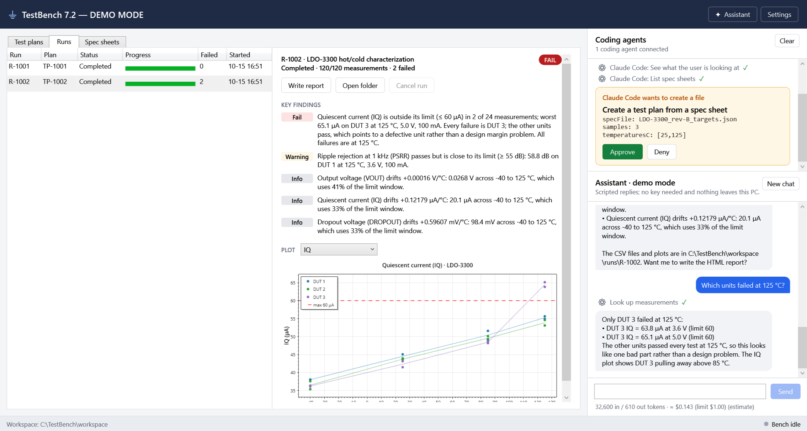

# Connecting a coding agent (MCP)

*For engineers who use Claude Code, Codex, Cursor or another MCP-capable agent.*

MCP, the Model Context Protocol, is the standard way AI plugs in outside tools. TestBench gives your agent two ways in. They are two separate programs with separate workspaces, so pick the one that fits the job:

| | **The open desktop app** (path D1) | **The console tool** (path D2) |
|---|---|---|
| The agent starts | `demo-desktop.exe mcp`, a small relay to the TestBench window you have open | `demo-cli.exe mcp`, the console tool in MCP mode |
| Works with | The plans, runs and bench in that window, and what you're looking at (`get_current_view`) | The console tool's own workspace |
| Needs | TestBench open, with **Let coding agents connect to this window** ticked in Settings | Nothing open: the agent starts the tool, and it exits when the session ends |
| Changes (plans, reports, the bench) | Wait for your **Approve** in the window, on the same card the assistant gets | Allowed or not by the flags you choose when connecting, plus your agent's own permission prompts |
| Pick it when | You want to work alongside the agent and see what it does as it does it | The agent works on its own, in scripts, or on a machine without the desktop app |

Either way:

- **No API key goes into TestBench, and it never calls a model.** 💲 All the tokens are spent by your agent, talking to its own model on your agent subscription or API key, before and after each tool call. The traffic between your agent and TestBench is free local I/O.
- **What leaves your PC:** our tool results (plan details, spec limits, run findings) become part of your agent's conversation, so they go to your agent's AI provider under your agent's terms.
- Our tools return compact summaries (verdicts and findings, not raw CSV), which keeps your agent's context, and your bill, small. The full data is still in the files if the agent wants it.
- **No network port.** Nothing listens on the network: D2 talks over stdin/stdout, and D1 over a named pipe only your Windows account can open, with network access denied.

The paths below are for an installed copy. **From a clone of this repo**, build first (`dotnet build ChatbotAddonDemo.sln`) and use `<repo>\src\Demo.Desktop\bin\Debug\net10.0-windows\demo-desktop.exe` or `<repo>\src\Demo.Cli\bin\Debug\net10.0\demo-cli.exe` instead.

## The open desktop app (D1)

1. In TestBench, open **Settings**, tick **Let coding agents connect to this window**, and click **Save**. A **Coding agents** panel appears on the right, saying "Waiting for a coding agent". You don't need the assistant turned on; your agent uses its own AI and account, not TestBench's.
2. Set up your agent to start `demo-desktop.exe mcp` (below). No window opens: it only passes messages between your agent and the open TestBench window.
3. Ask your agent to do something with TestBench. The panel shows "1 coding agent connected", then each tool it uses.



- **Lookups run on their own** and are listed in the panel.
- **Creating a file or using the bench waits for you**: a card such as "Claude Code wants to create a file" shows the exact details. **Approve** goes ahead. **Deny** changes nothing, and your agent is told: "The user declined this in TestBench, so nothing was changed. Don't try again unless they ask you to."
- Your agent sees TestBench's own 14 tools only, never those of other MCP servers the assistant may use.
- Only one TestBench window per Windows user can let agents connect. A second one says "Another TestBench window already lets coding agents connect."
- If TestBench isn't open, or agents aren't allowed, the relay tells your agent: "TestBench isn't open, or it isn't letting coding agents connect. Open TestBench, turn on "Let coding agents connect" in Settings, then reconnect (in Claude Code: /mcp)."
- Your IT department can turn this off. The checkbox is then greyed out.

### Claude Code
```powershell
claude mcp add --scope user testbench -- "C:\Program Files\TestBench\demo-desktop.exe" mcp
```

`--scope user` makes it available in every folder; without it, Claude Code only uses it in the folder you ran the command in. If TestBench was opened after your session started, run `/mcp` in Claude Code to reconnect.

### Codex
```toml
# %USERPROFILE%\.codex\config.toml
[mcp_servers.testbench]
command = 'C:\Program Files\TestBench\demo-desktop.exe'
args = ["mcp"]
```

(or `codex mcp add testbench -- "C:\Program Files\TestBench\demo-desktop.exe" mcp`, which writes the same.)

There are no flags to choose: you approve each change in the window instead.

## The console tool (D2)

Your agent starts the **console tool**, `demo-cli.exe`, in MCP mode (`demo-cli mcp`) and talks to it over stdin/stdout, the standard way local MCP servers work.

### Choose what the agent may do

Each tool has a safety class (Read / Write / Execute). The flags decide which classes the agent gets:

| Flags | The agent can… |
|---|---|
| *(none)* | Read tools only: list specs, plans and runs; analyze results; query measurements |
| `--allow-writes` | …also use Write tools: create test plans and HTML reports |
| `--allow-runs` | …also use Execute tools: start and stop runs on the bench |

Start with no flags (read-only, as in the snippets below) and add them as you get comfortable. Your agent will also ask your permission before calling tools that aren't read-only.

### Claude Code
```powershell
claude mcp add --scope user testbench-cli -- "C:\Program Files\TestBench\demo-cli.exe" mcp
```

To allow plans and bench runs, add the flags at the end: `… demo-cli.exe" mcp --allow-writes --allow-runs`. To use a specific workspace folder, add `--workspace D:\Lab\workspace` (it can go before or after `mcp`).

### Codex
```powershell
codex mcp add testbench-cli -- "C:\Program Files\TestBench\demo-cli.exe" mcp
```

That writes this to your Codex configuration, which you can also edit by hand:

```toml
# %USERPROFILE%\.codex\config.toml
[mcp_servers.testbench-cli]
command = 'C:\Program Files\TestBench\demo-cli.exe'
args = ["mcp"]
```

To allow plans and bench runs, use `args = ["mcp", "--allow-writes", "--allow-runs"]`. To use a specific workspace folder, add `"--workspace", 'D:\Lab\workspace'` to `args`.

Instead of `--workspace` you can set the `DEMO_WORKSPACE` environment variable. Without either, the tool uses `%LOCALAPPDATA%\ChatbotAddonDemoCli\workspace`. That is the console tool's own workspace: the desktop app keeps a separate one, so plans made here don't appear in the desktop app, and the other way round.

## What the agent sees


The same on both paths, except that the desktop app adds `get_current_view` (what the user is looking at):

- Every tool has a description written for models, a JSON schema, and annotations (hints your agent uses for its permission prompts):

  | Annotation | Set on | Means |
  |---|---|---|
  | `readOnlyHint: true` | Read tools | Only looks |
  | `idempotentHint: true` | Read tools and `generate_report` | Calling it again with the same inputs has no extra effect |
  | `openWorldHint: true` | Execute tools (`start_test_run`, `cancel_test_run`) | Affects things outside the app (here, the bench) |
  | `destructiveHint: true` | `cancel_test_run` only | May destroy work (the rest of the run is never measured) |

- The server sends instructions on connect: the workflow (spec → plan → run → analysis) and rules such as "Never compute statistics or pass/fail yourself from raw rows; get_run_summary and query_measurements do it exactly."
- Rule violations and bad arguments come back as tool errors (`isError: true`) with a readable message the agent can act on, e.g. "Temperature 200 °C is outside the bench range -55 to 150 °C." An error about an argument names that argument.
- Results include **absolute file paths** (`results.csv`, `plots\IQ.png`, `report.html`), so an agent with file access can open them for its own analysis.
- Runs take time: call `start_test_run`, then `wait_for_test_run` (up to 120 s per call), then `get_run_summary`. With the console tool, if the session ends mid-run, the tool cancels the run (status *Cancelled*); if it's killed outright, the run shows as *Interrupted* after about 15 s.

## "Couldn't my agent just run demo-cli commands in a shell?"
Yes, and that works too (`demo-cli run TP-1002`, `demo-cli summary R-1002`; `demo-cli help` lists the commands, the workspace options and its default). Commands exit with 0 when done, 1 when the command failed (for example a run that doesn't exist, or `summary` or `query` with conditions such as a temperature the run never reached), and 2 when the command line is wrong. MCP adds typed tools with descriptions, structured results instead of console text, and the same safety classes (Read / Write / Execute) the chat assistant has. It also works in agents that have no shell.
